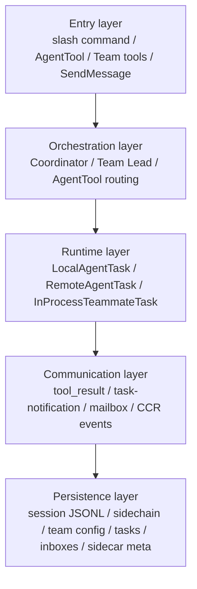
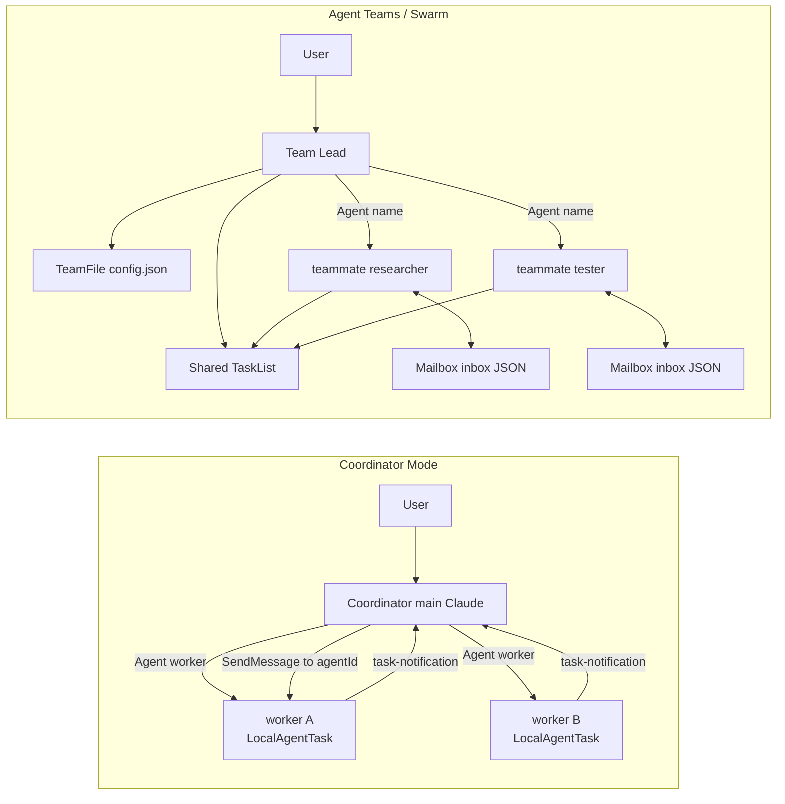
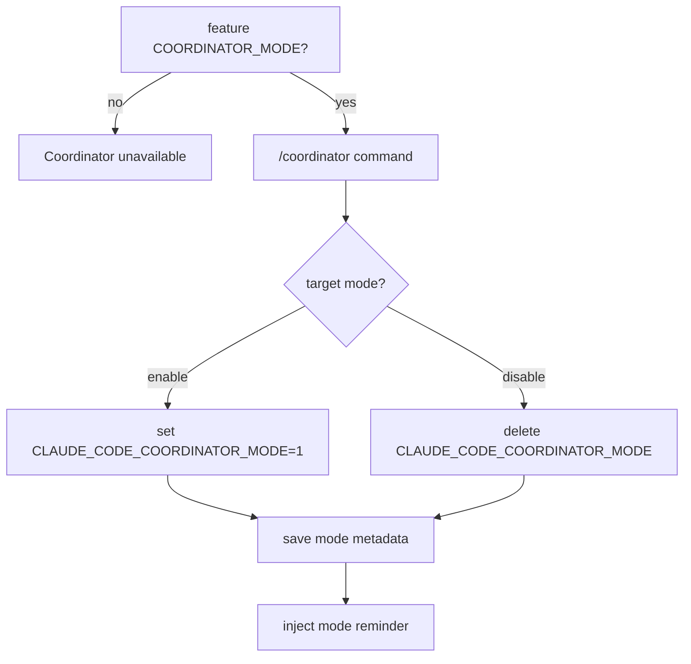
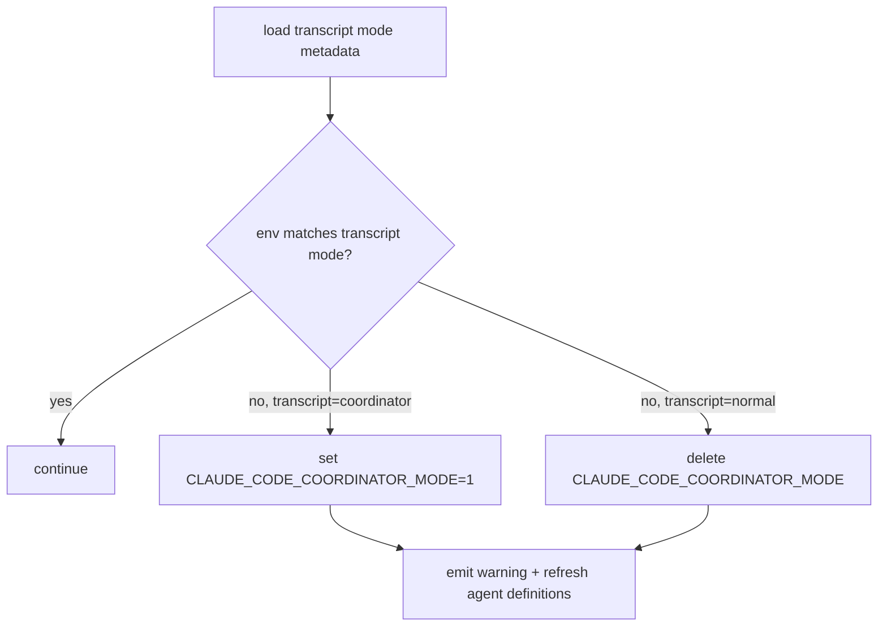
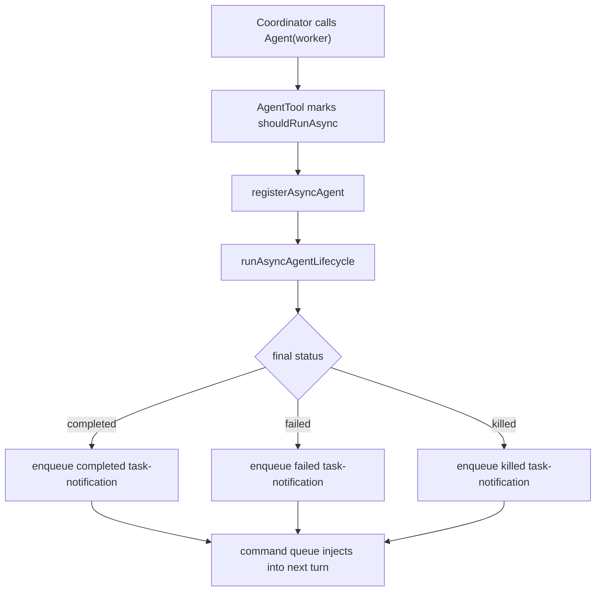
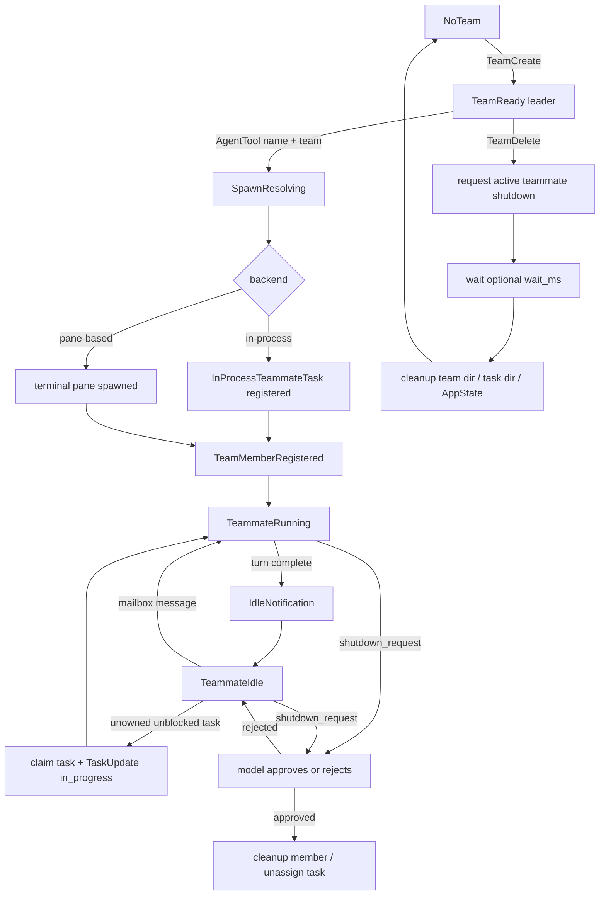
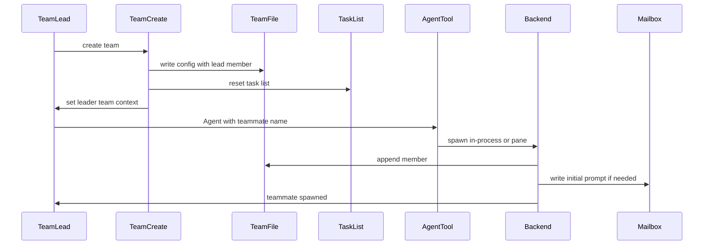
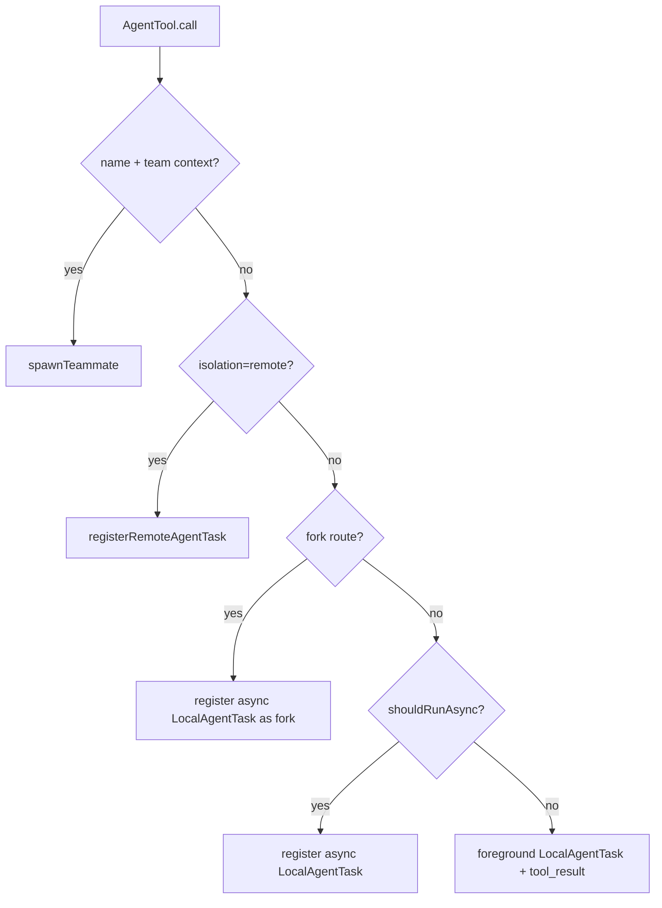
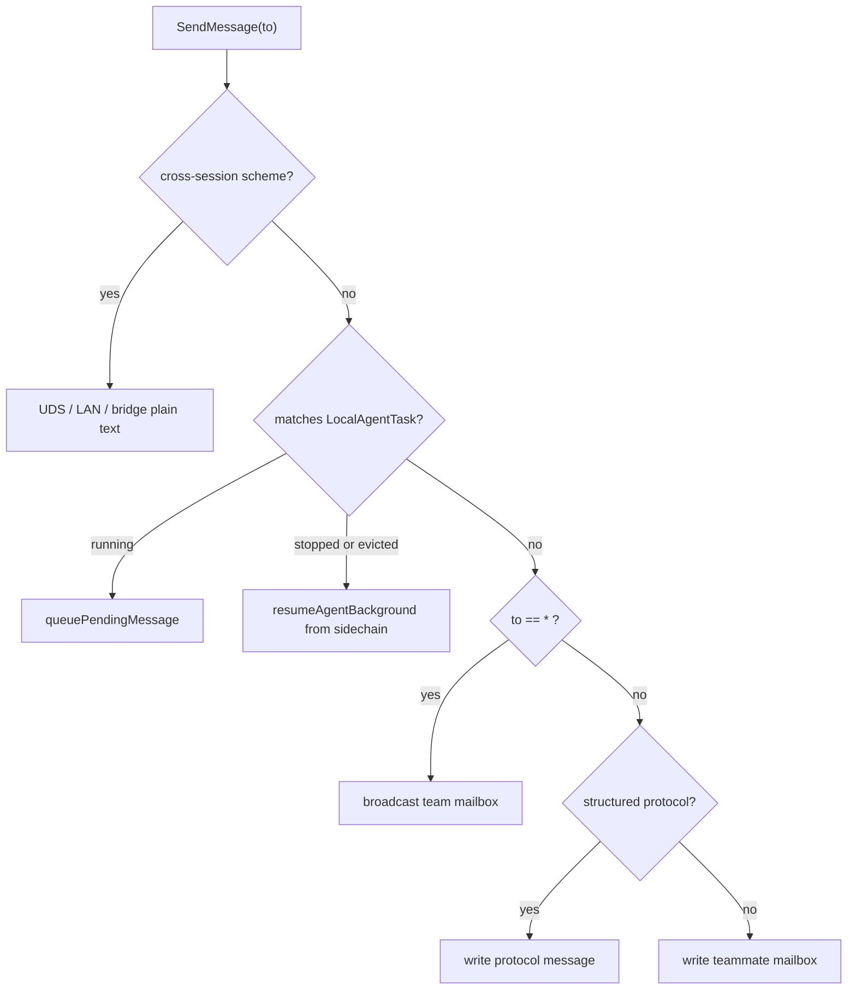
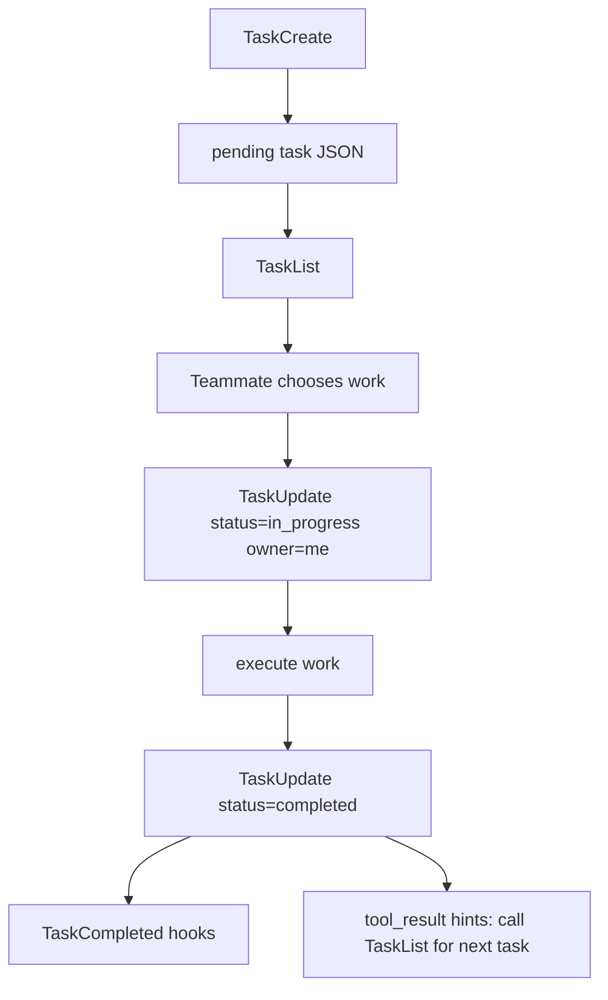

Claude Code has many things that all look like "multi-agent": the `Agent` tool, fork agents, Coordinator Mode, Agent Teams / Swarm, remote agents, background runtime tasks, and the `TaskCreate` task board. They share some underlying infrastructure, but they are not the same abstraction.

This document addresses cross-mechanism understanding. When you see a task being "dispatched", a teammate going idle, a `<task-notification>` returning to the main thread, or a team directory that still exists while its teammates no longer run, you should know which mechanism it belongs to, where its state lives, which path its communication takes, and what can be recovered.

## Global mental model

The shortest mental model:

```text
Agent sends someone off to do work.
TaskCreate pins a task card on the board.
A runtime task is a person (or a remote stand-in) that is currently running.
Coordinator is a star-shaped orchestrator.
Swarm is a team with members, mailboxes, and a task board.
```

First, flatten the terms:

| Concept | Essence | Entry point | State location | Result path |
|---|---|---|---|---|
| Plain sync subagent | One-shot foreground `Agent` tool call | `Agent({ subagent_type })` | foreground `LocalAgentTask` | `tool_result` of the current turn |
| Plain async subagent | One-shot background agent | `Agent({ subagent_type, async: true })` or automatic backgrounding | `AppState.tasks` + sidechain | `async_launched` + `<task-notification>` |
| Fork agent | Background branch that inherits the parent context and exact tools | Omit `subagent_type` when the fork gate is satisfied | `LocalAgentTask` + `.meta.json` | `<task-notification>` |
| Coordinator worker | `worker` async subagent dispatched by the Coordinator | Coordinator calls `Agent({ subagent_type: "worker" })` | `LocalAgentTask` | `<task-notification>` + `SendMessage(to: agentId)` |
| Swarm teammate | Long-lived team member | `Agent({ name, team_name?, prompt })` | `InProcessTeammateTask` or pane member | mailbox by name; can continue after going idle |
| Remote agent | Local mirror of a remote executor | `Agent(..., isolation: "remote")` | `RemoteAgentTask` + remote sidecar | CCR events / polling |
| Work item task | Entry on the shared task board | `TaskCreate/Update/List/Get` | `~/.claude/tasks/<taskListId>/*.json` | Claimed and updated by teammates / lead |
| Runtime task | A background executor that is running or has run | agent, shell, workflow, remote, etc. | `AppState.tasks` | UI, spinner, resume, kill |

## System layers

A multi-agent system can be viewed as five layers, each answering one question:

| Layer | Question it answers | Typical objects |
|---|---|---|
| Entry layer | Through which tool does a user or model start an action | `/coordinator`, `AgentTool`, `TeamCreate`, `SendMessage`, `TaskUpdate` |
| Orchestration layer | Who decomposes, dispatches, controls, and synthesizes | Coordinator, Team Lead, AgentTool routing |
| Runtime layer | Who actually executes or represents execution state | `LocalAgentTask`, `InProcessTeammateTask`, `RemoteAgentTask` |
| Communication layer | How results and control signals flow back | `tool_result`, `<task-notification>`, mailbox, CCR events |
| Persistence layer | What is still visible after a process restart | session JSONL, sidechain, team config, task files, inbox, sidecar meta |



The five layers do not map one-to-one. A Coordinator worker is a `LocalAgentTask` in the runtime layer, and communicates through `<task-notification>` and `SendMessage(to: agentId)`. A Swarm teammate may be an `InProcessTeammateTask` in the runtime layer and communicates through the mailbox. A remote agent is a local `RemoteAgentTask` mirror in the runtime layer, while the real execution state comes from CCR.

## Which mechanism to use when

| Scenario | Recommended mechanism | Why |
|---|---|---|
| You need one brain to decompose, dispatch, synthesize, and course-correct | Coordinator Mode | The main thread is restricted to orchestration, reducing direct tampering. |
| Several relatively independent tasks need long-lived teammates to keep claiming work | Agent Teams / Swarm | Provides team config, mailbox, and a shared task list. |
| You only want to dispatch one specialist to research or modify | Plain subagent | Low cost, short model path; the result returns directly to the current turn or as a background notification. |
| You want to copy the current context for parallel exploration | Fork agent | Inherits the parent context and exact tools; suited to branch exploration. |
| You want work to run in a remote environment | Remote agent | Only a `RemoteAgentTask` mirror stays local; execution happens in CCR. |

Two common misjudgments:

| Misjudgment | Better choice |
|---|---|
| "I want parallelism, so I must use Swarm" | For one-off research or verification, an async subagent or Coordinator worker is lighter. |
| "I want a team, so Coordinator is enough" | If members need to keep claiming shared tasks, message each other, and retain team state, use Swarm. |

## Two multi-agent topologies

Coordinator and Swarm are both multi-agent, but their control and state models are completely different.



| Dimension | Coordinator Mode | Agent Teams / Swarm |
|---|---|---|
| Topology | Star: Coordinator in the center, workers around it | Team: Team Lead + named teammates + mailbox + task list |
| Role of main Claude | Orchestrates only, never executes directly | Can execute directly, or act as team lead managing the team |
| Executor | Built-in `worker` async subagent | Teammate, either in-process or pane-based |
| Communication | `<task-notification>`, plus `SendMessage(to: agentId)` when needed | mailbox by name; supports P2P, broadcast, and structured protocols |
| Task collaboration | `TeamCreate/TaskList` are not central | `TeamFile` + shared task list + mailbox |
| Recovery model | Mode lives in the main transcript; workers are local agent sidechains | Team/task/inbox files can be retained; in-process runners are not fully recoverable |

Coordinator Mode is not a special Team Lead of Swarm. It shares infrastructure such as `AgentTool`, `LocalAgentTask`, and `SendMessage`, but it does not use `TeamCreate/TeamDelete/TaskList/TaskUpdate` as its core team-collaboration mechanism.

## Coordinator Mode: five state machines

The core design of Coordinator Mode is to demote the main Claude to an orchestrator: the main thread does not `Read/Edit/Bash` directly, but splits tasks, dispatches workers, synthesizes results, and stops or continues workers when needed.

### 1. Enablement state machine



Both conditions must hold to enter Coordinator:

| Condition | Role |
|---|---|
| `feature("COORDINATOR_MODE")` | Build/runtime feature gate. |
| `CLAUDE_CODE_COORDINATOR_MODE=1` | The current process actually enters coordinator mode. |

### 2. Recovery state machine

Coordinator mode is a session property, written as a `mode` entry in the main session JSONL:

```jsonl
{"type":"mode","sessionId":"...","mode":"coordinator"}
```

On resume, the current environment is aligned with the mode in the transcript:



This prevents a coordinator session from being resumed in a normal environment, or a normal session from being mistakenly run as a coordinator.

### 3. Prompt state machine

The coordinator prompt does not depend on the env alone. On the interactive REPL side the rough priority is:

| Priority | Source | Notes |
|---|---|---|
| 1 | override system prompt | Highest priority. |
| 2 | coordinator prompt | Used when `isCoordinatorMode()` is true and there is no `mainThreadAgentDefinition`. |
| 3 | main-thread agent prompt | `--agent` / settings agent. |
| 4 | custom/default prompt | Normal main-thread prompt. |
| 5 | append prompt | Additional appended text. |

The risk is mixing `--agent` with Coordinator: the tool pool may already be filtered for coordinator while the system prompt is not the coordinator's.

Headless needs separate attention. The current headless path explicitly applies coordinator tool filtering and injects the coordinator user context, but its system prompt assembly path is not identical to the interactive REPL, so treat it as a boundary that needs review rather than assuming it equals the interactive path.

### 4. Tool-filtering state machine

The Coordinator main thread and workers have different tool pools:

| Role | Tool pool | Design purpose |
|---|---|---|
| Coordinator main thread | `Agent`, `SendMessage`, `TaskStop`, `SyntheticOutput`, PR-activity subscription MCP tools | Orchestrate only, never execute directly. |
| worker | `ASYNC_AGENT_ALLOWED_TOOLS`, excluding `TeamCreate`, `TeamDelete`, `SendMessage`, `SyntheticOutput` | Execute tasks, but cannot nest further orchestration. |
| simple mode worker | `Bash`, `Read`, `Edit` | Smaller tool surface for simple execution paths. |
| MCP tools | Injected into the worker context per connected server | Lets workers use external capabilities while the tool pool controls the boundary. |
| scratchpad | Provides a scratchpad directory when the gate is on | Allows temporary knowledge sharing across workers. |

The interactive path mainly goes through `mergeAndFilterTools()`; the headless path applies coordinator tool filtering directly at the main entry; the worker tool pool is assembled independently by `AgentTool` and does not inherit the main thread's filtered pool.

### 5. Worker lifecycle

Under Coordinator, `Agent(worker)` is forced to be asynchronous:



`<task-notification>` is a user-role message, but it is not user input. The Coordinator prompt must treat it as a worker result signal:

```xml
<task-notification>
  <task-id>agent-a1b</task-id>
  <status>completed|failed|killed</status>
  <summary>Agent "Investigate auth bug" completed</summary>
  <result>Found null pointer in src/auth/validate.ts:42...</result>
  <usage>
    <total_tokens>N</total_tokens>
    <tool_uses>N</tool_uses>
    <duration_ms>N</duration_ms>
  </usage>
</task-notification>
```

The key Coordinator constraint is "synthesize, don't forward". Workers cannot see the full conversation between the user and the coordinator, so the prompt must be self-contained:

```text
Fix the null pointer in src/auth/validate.ts:42.
Session.user can be undefined when the session expires but the token remains cached.
Add a null check before user.id access; if null, return 401 with "Session expired".
Run validate.test.ts and report the commit hash.
```

The anti-pattern is:

```text
Based on your findings, fix it.
```

### Coordinator boundaries and troubleshooting

| Symptom | Likely cause | Resolution |
|---|---|---|
| Coordinator main thread cannot read files or run commands | The tool pool is filtered; this is expected | Dispatch a `worker`, and put the files, errors, and acceptance criteria into the worker prompt. |
| Coordinator behaves inconsistently after `--agent` | The agent prompt takes priority over the coordinator prompt, but tools may still be filtered | Avoid mixing them, or confirm the current system prompt source. |
| A worker is still running in the wrong direction | The runtime task is still `running` | Stop it with `TaskStop`; this produces a `killed` notification. |
| A worker finished but the conclusion is insufficient | It is a finished one-shot async agent | Prefer a fresh worker; use `SendMessage` to continue only when the sidechain must be preserved. |
| `SendMessage` fails | Agent not found, missing sidechain transcript, or message missing `summary` | Check the agentId/name and the sidechain `.jsonl/.meta.json`; remember to include `summary` for plain text messages. |
| No `worker` under coordinator | Built-in agents are disabled in non-interactive mode | Check `CLAUDE_AGENT_SDK_DISABLE_BUILTIN_AGENTS`. |

## Swarm full state machine

The core of Swarm is the team, not a single `Agent` call. `TeamCreate` creates the team, `Agent({ name })` adds a teammate, `TaskCreate/Update/List/Get` provide the task board, and `SendMessage` plus the mailbox provide communication and control.

The current implementation enables Agent Teams by default; setting `CLAUDE_CODE_EXPERIMENTAL_AGENT_TEAMS_DISABLED` turns it off.

### Team lifecycle



Key invariants:

| Invariant | Meaning |
|---|---|
| Flat roster | A teammate may not spawn another teammate, avoiding nested teams. |
| Mailbox addressed by name | The inbox path is `teamName + agentName`, not agentId. |
| The task list is a shared board | `TaskCreate` only writes a pending task; it does not start an executor. |
| Shutdown is not a forced kill | A shutdown request is handed to the model, and graceful shutdown happens only after it approves. |
| TeamFile is the cross-process source of truth | `AppState.teamContext` is a projection for the leader UI. |

### Storage topology

Swarm's core state lives in `~/.claude/teams` and `~/.claude/tasks`:

```text
~/.claude/
  teams/
    <team-name>/
      config.json
      inboxes/
        <agent-name>.json
  tasks/
    <team-name>/
      .highwatermark
      1.json
      2.json
      ...
```

| File or structure | Contents |
|---|---|
| `TeamFile` | `name`, `leadAgentId`, `leadSessionId`, `hiddenPaneIds`, `teamAllowedPaths`, `members[]`. |
| `TeamFile.members[]` | `agentId`, `name`, `agentType`, `model`, `color`, `backendType`, `isActive`, `mode`, `worktreePath`, `sessionId`. |
| task JSON | `id`, `subject`, `description`, `activeForm`, `owner`, `status`, `blocks`, `blockedBy`, `metadata`. |
| mailbox JSON | Plain messages, protocol messages, read state, color and summary, etc. |

### From TeamCreate to teammate



`TeamCreate` does more than write `config.json`. It also registers session cleanup, resets the team's task list, sets `leaderTeamName`, and projects the leader into `AppState.teamContext`.

When `AgentTool` sees `team_name/current teamContext + name`, it takes the teammate spawn branch instead of the plain `runAgent()`. `spawnTeammate()` resolves the team, makes the name unique, chooses a backend, updates `AppState.teamContext.teammates`, and then appends to `TeamFile.members`.

### in-process vs pane-based teammate

| Dimension | in-process teammate | pane-based teammate |
|---|---|---|
| Where it runs | Same process as the leader | Separate terminal pane / CLI process |
| How it starts | Registers `InProcessTeammateTask` and starts `runInProcessTeammate()` | Creates a tmux / iTerm2 / Windows Terminal pane |
| Message consumption | The runner polls the mailbox itself about every 500ms | `useInboxPoller()` on the leader / teammate side polls about every 1s |
| Input path | Teammate view input goes into `pendingUserMessages` | Plain mailbox prompts enter the teammate process |
| Handling priority | shutdown > team-lead message > peer message > unowned task claim | The poller routes by message type and automatically starts a turn when idle |
| UI | spinner tree, footer pills, detail dialog, teammate transcript view | footer TeamStatus, TeamsDialog, pane status |
| Recovery | Runner, AbortController, and pending queue are in memory; cannot be fully recovered after a process restart | The pane process may still be alive; the leader-side backend map is not persisted, so recovery is best-effort |
| Deletion | Needs the current AppState task / AbortController | Writes a shutdown request through the backend, then waits for the teammate to approve / clean up |

## AgentTool routing decision tree

`AgentTool.call()` is the most complex fork point among the multi-agent entries. The same `Agent` tool takes different runtimes depending on parameters and context:



| Route | Trigger condition | Result |
|---|---|---|
| teammate | Has `name`, and a `team_name` or current `teamContext` exists | `spawnTeammate()`, returns `teammate_spawned`. |
| remote | `isolation: "remote"` | Registers `RemoteAgentTask` and stores a remote sidecar locally. |
| fork | `subagent_type` omitted and the fork gate/context allows it | Forced background local agent that inherits the parent context and exact tools. |
| async local | Explicit async, Coordinator worker, or auto-backgrounding conditions met | Returns `async_launched`; injects `<task-notification>` on completion. |
| sync local | Default foreground one-shot subagent | The current tool call returns a `tool_result`. |

So the docs must not write "Agent" as a single concept: there are at least five runtime paths beneath the same tool entry.

## Communication path comparison

The communication path determines whether a result enters the current turn, whether it is persisted, and whether it can be resumed.

| Communication path | Sender | Receiver | Purpose | Persistence / recovery |
|---|---|---|---|---|
| `tool_result` | sync subagent | Current assistant turn | One-shot foreground result | Written to the main transcript. |
| `<task-notification>` | async local agent / coordinator worker | Next turn of the main thread | Background completed/failed/killed notification | Comes from the `LocalAgentTask` lifecycle and sidechain. |
| `SendMessage(to: agentId)` | Coordinator or user | local agent task | Continue a running/stopped worker | Queued while running; tries sidechain resume when stopped. |
| `SendMessage(to: teammateName)` | lead / teammate | teammate mailbox | Plain Swarm communication | Writes inbox JSON, addressed by name. |
| `SendMessage(to: "*")` | lead / teammate | team members | Swarm broadcast | Writes multiple inboxes; structured messages cannot be broadcast. |
| structured mailbox protocol | lead / teammate / runtime | A specific teammate or lead | permission, plan, shutdown, mode, task assignment | Stays unread for the poller to route; must not be swallowed by a plain attachment. |
| CCR events / polling | remote runtime | `RemoteAgentTask` | remote agent status and results | Local sidecar + remote session state. |

### SendMessage routing



A plain text `SendMessage` needs a `summary`. A structured message cannot be broadcast and cannot cross `uds/bridge/tcp` sessions. Within a single session a teammate name is a bare name; `to` should not be written as a cross-domain address containing `@`.

## Mailbox protocol table

The mailbox path is:

```text
~/.claude/teams/<team-name>/inboxes/<agent-name>.json
```

It has locking, atomic rename, size limits, and a compaction policy:

| Limit | Value |
|---|---|
| Single text | 64KB |
| Mailbox file | 4MB |
| Retained bytes | 2MB |
| Plain messages retained | Up to 1000 |
| Read messages retained | Up to 200 |
| Unread protocol messages retained | Up to 2000 |

Protocol messages are more than "chat":

| Message type | Typical sender | Typical receiver | Consumer | Should it enter the normal LLM context |
|---|---|---|---|---|
| plain text | lead / teammate | teammate / lead | mailbox attachment or prompt handler | Yes |
| broadcast | lead / teammate | team members | mailbox attachment or prompt handler | Yes |
| `task_assignment` | `TaskUpdate` | new owner | teammate poller / runner | Usually acts as a task trigger, not treated as small talk |
| `permission_request/response` | teammate / lead | lead / teammate | `useInboxPoller` + permission UI queue | No |
| `sandbox_permission_request/response` | teammate / sandbox host | lead / teammate | permission sync | No |
| `plan_approval_request/response` | teammate / lead | lead / teammate | plan approval path | No |
| `shutdown_request/approved/rejected` | lead / teammate | teammate / lead | backend / runner / poller | No |
| `mode_set_request` | lead | teammate | permission mode sync | No |
| `team_permission_update` | lead | team members | permission sync | No |
| idle notification | teammate runner | lead | UI / lead poller | Usually no |

An important boundary: the mailbox attachment consumes only unstructured messages; structured protocol messages should stay unread and be routed by `useInboxPoller` or the in-process runner. Otherwise permission, plan, and shutdown messages could be swallowed as ordinary context.

## A Task is not a Runtime Task

A `TaskCreate` task and a `LocalAgentTask` task are two different models.

| Name | Source type | Storage | State | Consumer |
|---|---|---|---|---|
| work item task | `Task` in `src/utils/tasks.ts` | `~/.claude/tasks/<taskListId>/<id>.json` | `pending/in_progress/completed` | Task tools, TaskList UI, teammate claiming |
| runtime task | `TaskStateBase` subtypes | `AppState.tasks`, some with sidecar/output | `running/completed/failed/killed`, etc. | UI, spinner, background selector, kill/resume |

Shared task lifecycle:



`TaskUpdate` is enhanced under Swarm:

| Behavior | Description |
|---|---|
| A teammate marks `in_progress` and the owner is empty | Automatically sets the owner to the current teammate name. |
| Owner changes | Writes a `task_assignment` to the new owner's mailbox. |
| status -> `completed` | Runs TaskCompleted hooks. |
| A teammate completes a task | The tool result appends a hint: run `TaskList` immediately to find the next item. |
| The main thread completes 3+ tasks with no verification | Appends a verification nudge under a feature gate. |

Runtime task types include:

| Type | Where it runs | Typical scenario |
|---|---|---|
| `LocalAgentTask` | Local sub-agent | Plain background agent, fork, coordinator worker. |
| `InProcessTeammateTask` | In-process runner | in-process teammate. |
| `RemoteAgentTask` | CCR remote session | remote agent. |
| `LocalShellTask` | Local shell | Background shell. |
| `LocalWorkflowTask` | Local workflow | Workflow orchestration. |
| `DreamTask` | Silent background | memory dream. |
| `MonitorMcpTask` | Local monitoring | MCP monitor. |

## Persistence and recovery matrix

Recoverability depends on where the state lives. The most important distinction: being able to see state does not mean being able to keep running.

| Mechanism | Persistence | Visible after resume | Can keep running after resume | Boundary |
|---|---|---|---|---|
| main session | Main session JSONL | Conversation chain, metadata, mode | Yes, restored as the main session | Affected by compact/branch/leaf. |
| coordinator mode | `mode` entry in the main session JSONL | Current session mode | Yes, `matchSessionMode()` switches the env | Prompt/tool state is still affected by current launch arguments. |
| coordinator worker | local agent sidechain + `.meta.json` | agent task identity and history | Usually via `resumeAgentBackground()` | Fails if the sidechain/meta is missing or tool definitions changed. |
| ordinary/fork subagent | local agent sidechain + `.meta.json` | agent history | Recoverable; fork depends on `agentType:"fork"` | Fork recovery needs correct metadata. |
| remote agent | `remote-agents/remote-agent-<taskId>.meta.json` + CCR | remote task mirror | Depends on CCR session state | 404/archive deletes the sidecar. |
| team config | `~/.claude/teams/<team>/config.json` | team/member roster | Does not mean the teammate runner is alive | `TeamFile` is the source of truth; `AppState` is a projection. |
| mailbox | `~/.claude/teams/<team>/inboxes/*.json` | Unread plain/protocol messages | Delivery can continue | Structured messages need the poller/runner to consume them correctly. |
| shared tasks | `~/.claude/tasks/<team>/*.json` | task list / owner / status | Can keep claiming/updating | An owner may point to a teammate that is no longer active. |
| in-process teammate runner | Leader process memory | Runner internal state is not fully visible | Cannot be fully recovered across processes | AbortController, pending queue, and recent messages are all in memory. |
| pane-based teammate | External pane + transcript + team file | May still be visible | Best-effort | The leader-side backend map is not persisted; active/kill depend on pane state. |

When debugging, ask in this order:

1. Do the files still exist?
2. Does the `AppState` projection still exist?
3. Is the runtime task still `running`?
4. Is the communication channel still usable?
5. Are the sidechain / inbox / remote sidecar sufficient for recovery?

## How user-visible state is projected

The UI shows projections of different state sources, not a single truth.

| UI | Data source | What it can tell you | What it cannot tell you |
|---|---|---|---|
| TaskListV2 | task files + `teamContext` | work item tasks, owner, status | That the teammate for an owner is still alive. |
| TeammateSpinnerTree | running in-process teammates | Teammate activity inside the current leader process | The full state of pane-based or historical teammates. |
| TeammateSpinnerLine | `InProcessTeammateTaskState` | idle, approval, stopping, tool/token, recent messages | The full transcript. |
| BackgroundAgentSelector | backgrounded `LocalAgentTask` | Selectable local background agents | remote/shell/workflow/in-process teammates. |
| agent transcript view | `viewingAgentTaskId` | Visualized conversation of a local agent or in-process teammate | The full external process state of a pane teammate. |
| TeamsDialog / TeamStatus | `AppState.teamContext` + team file | Team member display, management, kill/shutdown/mode | That the runner is recoverable. |

Pane-based teams are mainly managed through the footer TeamStatus and TeamsDialog: Enter to view, `k` to kill, `s` to shut down, `p` to prune idle teammates, and Shift+Tab to switch permission mode. Input in an in-process teammate's transcript view goes into `pendingUserMessages`, not the mailbox.

## Two end-to-end scenarios

### A complex bug with Coordinator

| Step | What happens | Executor | Communication | Persistence |
|---|---|---|---|---|
| 1 | The user raises a complex bug | Main session | user message | main JSONL |
| 2 | Coordinator splits into investigate, implement, verify | Coordinator main thread | `Agent(worker)` | main JSONL + task state |
| 3 | Workers execute asynchronously | `LocalAgentTask` | tool calls | sidechain JSONL |
| 4 | A worker completes | `LocalAgentTask` | `<task-notification>` | notification queue / main turn |
| 5 | Coordinator synthesizes the root cause | Main thread | assistant reasoning | main JSONL |
| 6 | Direction needs correcting | The same or a new worker | `SendMessage(to: agentId, summary, message)` or a fresh `Agent` | sidechain / new sidechain |
| 7 | Summary to the user | Main thread | assistant message | main JSONL |

This flow has no `TeamCreate` and does not depend on the shared task list.

### Long-running parallel work with Swarm

| Step | What happens | State source | Communication |
|---|---|---|---|
| 1 | `TeamCreate({ team_name })` | `teams/<team>/config.json` + `tasks/<team>` | tool result |
| 2 | `TaskCreate` for several work items | task JSON | Task tools |
| 3 | `Agent({ name: "researcher" })` | TeamFile member + backend task/pane | initial prompt |
| 4 | A teammate claims a task | task JSON owner/status | `TaskUpdate` |
| 5 | The lead sends a message | inbox JSON | `SendMessage(to: teammateName)` |
| 6 | A teammate finishes a turn | runner/poller state | idle notification |
| 7 | The teammate keeps claiming tasks | task list | `TaskList` / claim |
| 8 | `TeamDelete({ wait_ms })` | team/task dirs cleanup | shutdown request / response |

In this flow the team, task list, and mailbox are central. A teammate's output is not automatically given to the lead; it needs `SendMessage` or an explicit protocol message.

## Failure and troubleshooting matrix

| Symptom | Check first | Common cause | Resolution |
|---|---|---|---|
| Coordinator worker result did not come back | `AppState.tasks[agentId]`, notification queue, sidechain | The worker is still running, failed, was killed, or the notification has not yet entered the next turn | Wait for the next turn; or inspect the sidechain / task status. |
| `SendMessage(to: agentId)` cannot find the worker | agentId/name, sidechain `.jsonl/.meta.json` | The agent was evicted, metadata is missing, or a teammate name was passed | Use the correct raw agentId; spawn a new worker if necessary. |
| `SendMessage(to: teammate)` fails | teamContext, team file, inbox path | Teammate name misspelled, no team in the current session, or an address containing `@` was used | Use the bare teammate name within the current team. |
| Plain text `SendMessage` fails validation | Parameters | Missing `summary` | Add `summary`. |
| A structured message had no effect | inbox read state, poller | It was marked read as a plain attachment, or the consumer is not running | Confirm the structured message stays unread and the poller/runner is alive. |
| Tasks not displayed | `leaderTeamName`, `getTaskListId()`, tasks dir | The lead and teammate point to different task lists | Check env/teamName/sessionId precedence. |
| A task is claimed but nobody executes it | task owner, team member active, runner/pane | The owner teammate is inactive or its runner is lost | Reassign the owner, or restart the teammate. |
| TeamDelete refuses to clean up | `TeamFile.members[].isActive` | Active teammates remain | Gracefully shut them down first, or clean up manually after confirming. |
| Team exists after resume but teammates do not run | team file, runner/pane state | The in-process runner lived in the old process and cannot be recovered | Re-spawn teammates or re-orchestrate using the existing mailbox/tasks. |
| A pane teammate seems alive but the UI is inaccurate | paneId, backendType, backend map | The leader-side `spawnedTeammates` map is not persisted | Treat TeamFile + actual pane state as authoritative; manage best-effort. |
| permission/plan stuck | leader inbox, permission UI queue, protocol response | The leader poller did not consume it, or the response was not written back | Check `useInboxPoller` and the relevant inbox. |
| remote agent resume fails | remote sidecar, CCR session | Session 404 / archived | Accept the sidecar cleanup and recreate the remote agent. |

## Common misconceptions

| Misconception | Correct understanding |
|---|---|
| Coordinator is the Team Lead of Swarm | No. A Coordinator worker is an async subagent, not a teammate. |
| Swarm requires setting `CLAUDE_CODE_EXPERIMENTAL_AGENT_TEAMS=1` | The current implementation enables it by default; disable it with `CLAUDE_CODE_EXPERIMENTAL_AGENT_TEAMS_DISABLED`. |
| `TaskCreate` creates a running agent | It only creates a work item JSON; the executor is a `LocalAgentTask` / `InProcessTeammateTask`, etc. |
| A teammate's result automatically goes to the lead after a turn | Not necessarily. Teammates must communicate through `SendMessage`; the runner also sends an idle notification. |
| The mailbox is addressed by agentId | The Swarm mailbox is addressed by teammate name. |
| BackgroundAgentSelector lists all background tasks | It lists only backgrounded `LocalAgentTask`s, not remote/shell/workflow/in-process teammates. |
| `TeamUpdate` is a tool | The current source has no standalone `TeamUpdateTool`; team member updates are spread across spawn, teamHelpers, and dialogs. |
| `SyntheticOutput` is Swarm's internal communication tool | It is mainly for structured output and is not central to team collaboration. |
| A shutdown request is a forced kill | No, it is a graceful shutdown protocol handled by the model. |
| An in-process teammate can be resumed across processes like a local agent | No. The runner's runtime state is in memory and cannot be fully recovered after a process restart. |

## Further reading

This document is a cross-mechanism overview. To go deeper into a specific path, see the dedicated documents first:

| To go deeper into | Read |
|---|---|
| `AgentTool` parameters, sync/async/fork, notification queue | `docs/agent/sub-agents.mdx` |
| Task V2 data model, locks, high-water mark, owner, hooks | `docs/tools/task-management.mdx` |
| JSONL transcript, sidechain, compact, resume, remote sidecar | `docs/internals/session-transcript-persistence.md` |
| The Coordinator feature on its own | `docs/features/coordinator-mode.md` |
| worktree isolation | `docs/agent/worktree-isolation.mdx` |

## Source entry index

| Question | Start here |
|---|---|
| coordinator mode detection, recovery, prompt, context | `src/coordinator/coordinatorMode.ts` |
| `/coordinator` command | `src/commands/coordinator.ts` |
| coordinator worker definition | `src/coordinator/workerAgent.ts` |
| system prompt selection | `src/utils/systemPrompt.ts` |
| coordinator tool filtering | `src/utils/toolPool.ts` |
| coordinator mode persistence | `mode` entry / `saveMode()` in `src/utils/sessionStorage.ts` |
| AgentTool routing | `packages/builtin-tools/src/tools/AgentTool/AgentTool.tsx` |
| subagent query loop | `packages/builtin-tools/src/tools/AgentTool/runAgent.ts` |
| async local agent lifecycle | `packages/builtin-tools/src/tools/AgentTool/agentToolUtils.ts` |
| local agent runtime task | `src/tasks/LocalAgentTask/LocalAgentTask.tsx` |
| remote agent runtime task | `src/tasks/RemoteAgentTask/RemoteAgentTask.tsx` |
| agent resume | `packages/builtin-tools/src/tools/AgentTool/resumeAgent.ts` |
| task stop | `packages/builtin-tools/src/tools/TaskStopTool/TaskStopTool.ts`, `src/tasks/stopTask.ts` |
| team gate | `src/utils/agentSwarmsEnabled.ts` |
| team file helpers | `src/utils/swarm/teamHelpers.ts` |
| TeamCreate | `packages/builtin-tools/src/tools/TeamCreateTool/TeamCreateTool.ts` |
| TeamDelete | `packages/builtin-tools/src/tools/TeamDeleteTool/TeamDeleteTool.ts` |
| spawn teammate | `packages/builtin-tools/src/tools/shared/spawnMultiAgent.ts` |
| in-process teammate spawn | `src/utils/swarm/spawnInProcess.ts` |
| in-process teammate runner | `src/utils/swarm/inProcessRunner.ts` |
| pane backend | `src/utils/swarm/backends/PaneBackendExecutor.ts` |
| teammate AsyncLocalStorage identity | `src/utils/teammateContext.ts` |
| mailbox | `src/utils/teammateMailbox.ts` |
| permission sync | `src/utils/swarm/permissionSync.ts` |
| SendMessage routing | `packages/builtin-tools/src/tools/SendMessageTool/SendMessageTool.ts` |
| shared task list | `src/utils/tasks.ts` |
| Task tools | `packages/builtin-tools/src/tools/TaskCreateTool`, `TaskUpdateTool`, `TaskListTool`, `TaskGetTool` |
| inbox polling | `src/hooks/useInboxPoller.ts` |
| swarm initialization | `src/hooks/useSwarmInitialization.ts` |
| teammate view | `src/state/teammateViewHelpers.ts`, `src/screens/REPL.tsx` |
| teammate spinner | `src/components/Spinner/TeammateSpinnerTree.tsx`, `TeammateSpinnerLine.tsx` |
| team dialog/status | `src/components/teams/TeamsDialog.tsx`, `src/components/teams/TeamStatus.tsx` |
| background local agent selector | `src/hooks/useBackgroundAgentTasks.ts`, `src/components/tasks/BackgroundAgentSelector.tsx` |
