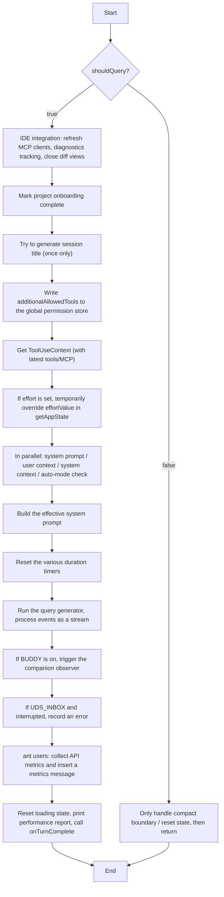

{/* Goal of this chapter: expose, from the source, the full path of session orchestration, persistent storage, cost tracking, and model switching */}

First, distinguish the several ways of interacting with Claude Code.

The REPL is about the interaction form, the SDK is about how you integrate, and ACP is about the communication protocol.

### Core concept comparison

| Dimension | REPL (interaction form) | SDK (integration method) | ACP (communication protocol) |
| :--- | :--- | :--- | :--- |
| **What it is** | An **interactive conversation environment** that developers use directly in the terminal | A **programmatic library** for developers, to be embedded in other applications | An **open communication standard** connecting different AI agents and editors |
| **How it is used** | 1. Type the `claude` command in the terminal<br>2. Enter a dedicated UI (rendered with React Ink)<br>3. Interact through slash commands (such as `/help`) | 1. Install the SDK package in your own Node.js/Python project (such as `npm install claude-code-sdk`)<br>2. Send queries through the API | 1. Launch Claude Code through an ACP adapter (such as `claude-code-acp`)<br>2. Editors talk to it over the ACP protocol |
| **Typical scenario** | A developer writing code day to day, asking questions, changing code, or running tasks at any time | Embedding Claude Code's core capabilities (conversation, tool execution, and so on) into automation scripts, CI/CD pipelines, or the backend of another application | Bringing Claude Code into third-party editors such as JetBrains IDEs and Zed, using their UI interaction features |
| **Main traits** | - **Human-facing**: interactive, intuitive<br>- **Feature-complete**: all built-in tools plus MCP integration<br>- **Handles complex tasks**: plans and executes multi-step operations on its own | - **Program-facing**: programmatic, embeddable<br>- **Lightweight**: does not depend on Claude Code's full runtime<br>- **Under your control**: suited to automation inside your own applications | - **Standardized**: unifies communication between different agents and editors<br>- **Bidirectional**: the agent can proactively ask the editor for files, run commands, and so on<br>- **Deep editor integration**: can fully reuse Claude Code's capabilities |

The SDK and ACP modes use the QueryEngine described below for session management.

As a conversation terminal (the REPL interaction form), Claude Code instead uses `onQueryImpl` in `src/screens/REPL.tsx`, which calls the `query()` function.

The call chain for the REPL mode is:
```
User input
  ↓
onSubmit (REPL.tsx)
  ↓
handlePromptSubmit (handlePromptSubmit.ts)
  ↓
executeUserInput (handlePromptSubmit.ts)
  ↓
onQuery (REPL.tsx)
  ↓
onQueryImpl (REPL.tsx)
  ↓
query (query.ts) ← called here
```

Where:

The `query` function is the core implementation of the Agentic Loop, with a `while(true)` loop that handles conversation turns (`query.ts:460-522`).

`onQueryImpl` is the core controller in the REPL (Read-Eval-Print Loop) that talks to the AI model. It is responsible for:

1. Environment preparation (IDE, diagnostics, permissions)

2. Generating the session title the first time

3. Building the dynamic system prompt and user context

4. Running the streaming query and updating the UI in real time

5. Collecting performance metrics and final cleanup

## A detailed walkthrough of `onQueryImpl`
This section walks through `onQueryImpl`. It is an async function wrapped in a React `useCallback`, and it handles the **complete query flow** from a user message to the AI model (Claude): preprocessing, system prompt construction, tool context preparation, streaming query execution, post-processing, and metrics recording.

---

### 1. Function signature and parameters

```typescript
const onQueryImpl = useCallback(
  async (
    messagesIncludingNewMessages: MessageType[],
    newMessages: MessageType[],
    abortController: AbortController,
    shouldQuery: boolean,
    additionalAllowedTools: string[],
    mainLoopModelParam: string,
    effort?: EffortValue,
  ) => { ... },
  [ ...dependencies ]
)
```

| Parameter                        | Description                                                                              |
| -------------------------------- | ---------------------------------------------------------------------------------------- |
| `messagesIncludingNewMessages` | The full message list including the new messages, used to build the model input          |
| `newMessages`                  | The messages added this time (for example, the text or attachments the user just entered) |
| `abortController`              | Controller used to cancel the current query                                              |
| `shouldQuery`                  | Whether to actually run the query; if `false`, the model call is skipped (for example, for invalid slash commands or a manual compact) |
| `additionalAllowedTools`       | Extra tools allowed for this query (usually from a Skill's frontmatter)                  |
| `mainLoopModelParam`           | The main model to use for this query (such as `'claude-3-opus'`)                         |
| `effort`                       | Optional; overrides the global "effort" value (controls how deeply the model reasons)    |

---

### 2. Overall execution flow

The diagram below summarizes the main branches and key steps:



---

### 3. Core logic in detail

#### 3.1 IDE integration and diagnostics (only when `shouldQuery = true`)

```typescript
const freshClients = mergeClients(initialMcpClients, store.getState().mcp.clients);
diagnosticTracker.handleQueryStart(freshClients);
const ideClient = getConnectedIdeClient(freshClients);
if (ideClient) closeOpenDiffs(ideClient);
```

- Gets the latest MCP clients from the store (because `useManageMCPConnections` may have updated state after the closure captured it).
- Notifies the diagnostics tracker that a query is starting.
- If a connected IDE client exists, closes all open diff views (cleaning up the environment).

#### 3.2 Session title generation (once only)

```typescript
if (!titleDisabled && !sessionTitle && !agentTitle && !haikuTitleAttemptedRef.current) {
  const firstUserMessage = newMessages.find(m => m.type === 'user' && !m.isMeta);
  const text = getContentText(firstUserMessage.message.content);
  if (text && !text.startsWith(`<${LOCAL_COMMAND_STDOUT_TAG}>`) ... ) {
    haikuTitleAttemptedRef.current = true;
    generateSessionTitle(text, ...).then(title => setHaikuTitle(title));
  }
}
```

- Runs only when titles are not globally disabled, no title exists yet, and no attempt has been made before.
- Extracts the real text of the first **non-meta user message** from the new messages.
- Skips synthetic breadcrumbs (such as slash command output and skill expansion markers).
- Calls `generateSessionTitle` asynchronously and saves the result through `setHaikuTitle`; on failure it resets the ref so a retry is allowed.

#### 3.3 Writing permission tool overrides to the store

```typescript
store.setState(prev => {
  const cur = prev.toolPermissionContext.alwaysAllowRules.command;
  if (cur === additionalAllowedTools || (cur?.length === ...)) return prev;
  return { ...prev, toolPermissionContext: { ...prev.toolPermissionContext, alwaysAllowRules: { ...prev.toolPermissionContext.alwaysAllowRules, command: additionalAllowedTools } } };
});
```

- Writes this query's `additionalAllowedTools` to `toolPermissionContext.alwaysAllowRules.command` in the global store.
- Used to limit the toolset available in this query (for example, Skill-specific tools).
- A shallow comparison avoids unnecessary state updates.
- It also runs when `shouldQuery=false` (for example, forked commands need this permission information): in the original code this sits **before** the `shouldQuery` branch, so it always updates.

#### 3.4 The `shouldQuery = false` branch

```typescript
if (!shouldQuery) {
  if (newMessages.some(isCompactBoundaryMessage)) {
    setConversationId(randomUUID());
    if (feature('PROACTIVE') || feature('KAIROS')) proactiveModule?.setContextBlocked(false);
  }
  resetLoadingState();
  setAbortController(null);
  return;
}
```

- Handles cases that do not need an actual model call (such as an invalid slash command typed by the user, or a manual `/compact`).
- If the new messages contain a **compact boundary message**:
  - A new `conversationId` is generated, which makes the message row components in the UI remount.
  - If the PROACTIVE/KAIROS features are on, the context-blocked flag is cleared (restoring proactive prompts).
- Finally the loading state is reset and the abortController is cleared.

#### 3.5 Pre-query preparation (`shouldQuery = true`)

##### 3.5.1 Getting the ToolUseContext

```typescript
const toolUseContext = getToolUseContext(messagesIncludingNewMessages, newMessages, abortController, mainLoopModelParam);
const { tools: freshTools, mcpClients: freshMcpClients } = toolUseContext.options;
```

- `getToolUseContext` reads the latest tools and MCP client configuration from the store, so stale values captured by the closure cannot cause newly connected tools or MCP servers to be missed.

##### 3.5.2 Effort override (temporary)

```typescript
if (effort !== undefined) {
  const previousGetAppState = toolUseContext.getAppState;
  toolUseContext.getAppState = () => ({ ...previousGetAppState(), effortValue: effort });
}
```

- If an `effort` argument is passed, it temporarily overrides the `effortValue` returned by `getAppState`.
- The scope is **this query only**. The global store is untouched, so background agents and UI components cannot read the temporary value by mistake.

##### 3.5.3 Fetching prompts and context in parallel

```typescript
const [, , defaultSystemPrompt, baseUserContext, systemContext] = await Promise.all([
  undefined,
  feature('TRANSCRIPT_CLASSIFIER') ? checkAndDisableAutoModeIfNeeded(...) : undefined,
  getSystemPrompt(freshTools, mainLoopModelParam, additionalWorkingDirectories, freshMcpClients),
  getUserContext(),
  getSystemContext(),
]);
```

- These tasks run in parallel to save time:
  - **Auto-mode circuit breaker**: if the transcript classifier is enabled, checks and may disable fast mode (`fastMode`).
  - **System prompt**: generated from the latest tools, model parameter, extra working directories, and MCP clients.
  - **User context**: such as the current workspace and environment variables.
  - **System context**: such as operating system and terminal information.

##### 3.5.4 Enriching the user context

```typescript
const userContext = {
  ...baseUserContext,
  ...getCoordinatorUserContext(freshMcpClients, getScratchpadDir()),
  ...((feature('PROACTIVE') || feature('KAIROS')) && proactiveModule?.isProactiveActive() && !terminalFocusRef.current
    ? { terminalFocus: 'The terminal is unfocused — the user is not actively watching.' }
    : {}),
};
```

- Merges the base user context, the coordinator context (related to MCP collaboration), and an optional terminal focus state (when the proactive feature is active and the terminal is unfocused, the model is told the user is not watching).

##### 3.5.5 Building the final system prompt

```typescript
const systemPrompt = buildEffectiveSystemPrompt({
  mainThreadAgentDefinition,
  toolUseContext,
  customSystemPrompt,
  defaultSystemPrompt,
  appendSystemPrompt,
});
```

- Combines the main-thread agent definition, the tool context, the custom system prompt, the default system prompt, and any content to append.

#### 3.6 Running the query and handling streaming events

```typescript
resetTurnHookDuration(); resetTurnToolDuration(); resetTurnClassifierDuration();
for await (const event of query({ messages, systemPrompt, userContext, systemContext, canUseTool, toolUseContext, querySource })) {
  onQueryEvent(event);
}
```

- Resets the hook, tool, and classifier duration timers for this query.
- Calls the `query` generator function (which talks to the model API and returns an SSE event stream).
- Iterates over each event and calls `onQueryEvent` (typically to update the UI message list, handle tool calls, and so on).

#### 3.7 Post-processing and metrics collection

##### 3.7.1 The BUDDY feature (companion reactions)

```typescript
if (feature('BUDDY') && typeof fireCompanionObserver === 'function') {
  fireCompanionObserver(messagesRef.current, reaction => setAppState(prev => ({ ...prev, companionReaction: reaction })));
}
```

- Passes the current message list to the companion observer and updates global state from the reaction it returns.

##### 3.7.2 UDS_INBOX interrupt handling

```typescript
if (feature('UDS_INBOX') && abortController.signal.aborted) {
  pipeReturnHadErrorRef.current = true;
  relayPipeMessage({ type: 'error', data: 'Slave request was interrupted before completion.' });
}
```

- If the query did not finish because of an interrupt, flags an error and relays a message through the pipe.

##### 3.7.3 API metrics for internal ant users

```typescript
if (process.env.USER_TYPE === 'ant' && apiMetricsRef.current.length > 0) {
  const entries = apiMetricsRef.current;
  const ttfts = entries.map(e => e.ttftMs);
  const otpsValues = entries.map(e => { /* compute per-request OTPS */ });
  const isMultiRequest = entries.length > 1;
  // create the API metrics message and add it to the message list
  setMessages(prev => [...prev, createApiMetricsMessage({ ttftMs: isMultiRequest ? median(ttfts) : ttfts[0], ... })]);
}
```

- Runs only when the user type is `'ant'` and API metrics have been recorded.
- Collects the **time to first token (TTFT)** and **output tokens per second (OTPS)** for each request.
- If the query contained several requests (for example, a tool-call loop), the median (P50) is computed and stored in the metrics message.
- It also records hook time, tool time, classifier time, total turn duration, number of config writes, and so on.

##### 3.7.4 Reset and cleanup

```typescript
resetLoadingState();
logQueryProfileReport();
await onTurnComplete?.(messagesRef.current);
```

- Resets the loading state (hides the loading indicator).
- Prints the query performance report (if the debug flag is enabled).
- Calls the externally supplied `onTurnComplete` callback with the full message list (typically to trigger follow-up behavior such as auto-scroll or saving the session).


## Single turn vs. multi-turn: the architectural difference

- **Single turn** (one Agentic Loop): one full execution of `query()` — assemble context → call the API → handle tool calls → loop until done
- **Multi-turn** (one Session): one session managed by the `QueryEngine` class — spanning dozens of `submitMessage()` calls and lasting hours

`QueryEngine` (`src/QueryEngine.ts`, class definition) is the **session orchestrator** on top of the single-turn Agentic Loop, and the state it manages goes well beyond the message list:

```
QueryEngine internal state (constructor in src/QueryEngine.ts)
├── mutableMessages: Message[]         ← full conversation history, accumulated across turns
├── readFileState: FileStateCache      ← cache of file contents already read, avoids re-reading
├── totalUsage: NonNullableUsage       ← cumulative token usage (input/output/cache)
├── permissionDenials: SDKPermissionDenial[]  ← record of permission denials
├── discoveredSkillNames: Set<string>  ← skills discovered in the current turn
├── loadedNestedMemoryPaths: Set<string>  ← nested memory paths already loaded (prevents duplicates)
├── hasHandledOrphanedPermission: boolean  ← whether an orphaned permission request was handled
└── abortController: AbortController   ← session-level interrupt control
```

## QueryEngine's core method: submitMessage()

Each time the user enters a message, the SDK calls `submitMessage()`, which runs the full turn initialization chain:

```typescript
// src/QueryEngine.ts — simplified flow of QueryEngine.submitMessage()
async *submitMessage(
  prompt: string | ContentBlockParam[],
  options?: { uuid?: string; isMeta?: boolean },
): AsyncGenerator<SDKMessage> {
  // 1. Clear turn-level tracking state
  this.discoveredSkillNames.clear()

  // 2. Resolve the model (the user may have switched models mid-session via setModel())
  const mainLoopModel = this.config.userSpecifiedModel
    ? parseUserSpecifiedModel(this.config.userSpecifiedModel)
    : getMainLoopModel()

  // 3. Assemble the System Prompt dynamically (rebuilt every turn)
  const { defaultSystemPrompt, userContext, systemContext } =
    await fetchSystemPromptParts({ tools, mainLoopModel, mcpClients })

  // 4. Wrap the permission check (tracks every denial)
  const wrappedCanUseTool = async (tool, input, ...) => {
    const result = await canUseTool(tool, input, ...)
    if (result.behavior !== 'allow') {
      this.permissionDenials.push({
        type: 'permission_denial',
        tool_name: sdkCompatToolName(tool.name),
        tool_use_id: toolUseID,
        tool_input: input,
      })
    }
    return result
  }

  // 5. Call the core query() function to run the agentic loop
  yield* query({
    systemPrompt, messages: this.mutableMessages,
    tools, model: mainLoopModel, ...
  })
}
```

A key design point: `submitMessage()` is an `async *Generator`. It yields `SDKMessage` step by step so the caller (REPL/SDK) can show progress in real time instead of waiting for the whole turn to finish.

## Session persistence: JSONL transcript

Every conversation event is appended to a transcript file (`src/utils/sessionStorage.ts`):

### Storage path

```
~/.claude/projects/<sanitized-cwd>/<session-uuid>.jsonl
```

- The path comes from `getProjectDir(originalCwd)`, which uses `sanitizePath()` to turn the project directory path into a safe directory name (not a hash). Sessions from the same project directory go in the same subdirectory.
- Each record is one line of JSON (JSONL format), which supports appending without reading, modifying, and rewriting the whole file
- Reads are capped at 50MB (the `MAX_TRANSCRIPT_READ_BYTES` constant in `src/utils/sessionStorage.ts`) to keep oversized sessions from causing OOM

### The transcript writer

The `Project` class (`src/utils/sessionStorage.ts`, a private class) manages transcript writes. It uses `writeQueues` (write queues grouped by file) and `drainWriteQueue()` (timed batch flushing) so concurrent message appends do not overwrite each other:

```
Write flow (async queued path):
  recordTranscript(sessionId, entry)
    ↓
  project.enqueueWrite(filePath, entry)    ← enqueue into writeQueues
    ↓
  scheduleDrain()                          ← set a timer (FLUSH_INTERVAL_MS)
    ↓
  drainWriteQueue()                        ← split into batches by MAX_CHUNK_BYTES
    ↓  write each batch
  appendToFile(path, batchContent)         ← batch append
    ↓
  If remote persistence is configured:
    persistToRemote(sessionId, entry)
      ├── CCR v2: internalEventWriter('transcript', entry)
      └── v1 Ingress: sessionIngress.appendSessionLog(...)

Synchronous direct-write path (for metadata rewrites and similar cases):
  appendEntryToFile(fullPath, entry)       ← synchronous appendFileSync
    ↓
  On failure: mkdir + retry
```

### Session resume path

The resume flow triggered by the `--resume` argument (the `--resume` branch in `src/main.tsx`):

```
1. Parse the resume argument:
   ├── UUID format → getTranscriptPathForSession(uuid)
   ├── .jsonl file path → use directly
   └── boolean → picker for the most recent sessions

2. loadTranscriptFromFile(path)
   ├── Parse line by line as JSONL
   ├── Filter for message-type records
   └── Rebuild the Message[] array

3. Restore context state:
   ├── restoreCostStateForSession(sessionId)  ← restore cumulative cost
   ├── Restore agentSetting (the Agent type the user chose)
   └── If --rewind-files is given, restore files to the snapshot at that message

4. Create QueryEngine({ initialMessages: restoredMessages })
   └── Continue the conversation from the restored messages
```

## Cost tracking: from API Usage to dollars

Cost tracking spans three modules, forming a complete record → accumulate → display chain:

### Record layer: Usage in the API response

Each `message_delta` event carries a `usage` field (`input_tokens`, `output_tokens`, `cache_creation_input_tokens`, `cache_read_input_tokens`). `accumulateUsage()` adds the incremental usage to the session total.

### Accumulation layer: cost-tracker.ts

```typescript
// src/cost-tracker.ts — StoredCostState type definition
type StoredCostState = {
  totalCostUSD: number                       // cumulative spend in USD
  totalAPIDuration: number                   // total API call time (including retries)
  totalAPIDurationWithoutRetries: number     // pure inference time without retries
  totalToolDuration: number                  // total tool execution time
  totalLinesAdded: number                    // lines of code added
  totalLinesRemoved: number                  // lines of code removed
  lastDuration: number | undefined           // duration of the most recent session
  modelUsage: { [modelName: string]: ModelUsage } | undefined  // usage broken down by model
}
```

`addToTotalSessionCost()` computes the cost of each API call from the model's pricing and adds it to `totalCostUSD`. The per-model `ModelUsage` allows separate accounting when the model is switched within one session.

### Persistence: surviving restarts

```typescript
// Saved to the project config at the end of each session
saveCurrentSessionCosts(sessionId)
  → projectConfig.lastCost = totalCostUSD
  → projectConfig.lastSessionId = sessionId
  → projectConfig.lastModelUsage = modelUsage
```

### Budget circuit breaker

`QueryEngineConfig.maxBudgetUsd` provides a hard session-level budget cap. In the REPL, when cumulative cost exceeds $5 (the cost-threshold `useEffect` in `src/screens/REPL.tsx`), a cost reminder dialog pops up. This is not a hard block but a "soft reminder", and it is shown only when `hasConsoleBillingAccess()` is true.

## Hot model switching

Switching models within a session does not lose conversation history, because `mutableMessages` is decoupled from the model choice:

```
/model sonnet → QueryEngine.setModel('claude-sonnet-4-20250514')
  ↓  what actually happens: this.config.userSpecifiedModel = model (the QueryEngine.setModel() method)
At the start of the next submitMessage():
  ↓
parseUserSpecifiedModel(this.config.userSpecifiedModel)
  → returns the new model config
  ↓
fetchSystemPromptParts({ mainLoopModel: newModel })
  → System Prompt is reassembled for the new model's capabilities
  ↓
query({ model: newModel, messages: this.mutableMessages })
  → continues the conversation with the full history + the new model
```

On a model switch, `contextWindowTokens` and `maxOutputTokens` are also recomputed from the new model's specs. For example, switching from Sonnet to Opus may change the context window from 200K to 1M.

## File snapshots and rollback

`fileHistoryMakeSnapshot()` (`src/utils/fileHistory.ts`) automatically saves the current contents before every file change the AI makes. A snapshot is bound to a specific `message.id`, so `--rewind-files <user-message-id>` can restore file state to any point in the conversation. This is finer-grained than git, which only tracks what has been committed.
