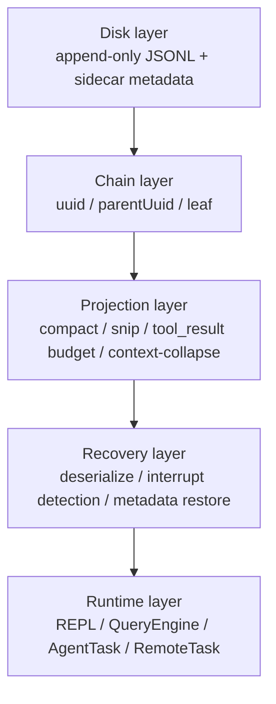
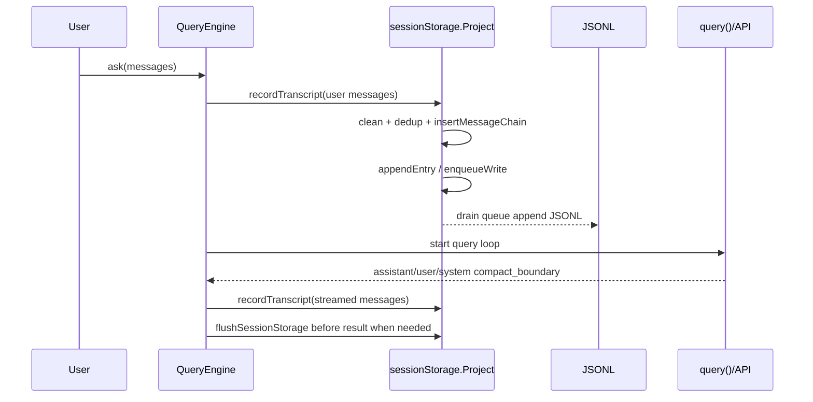
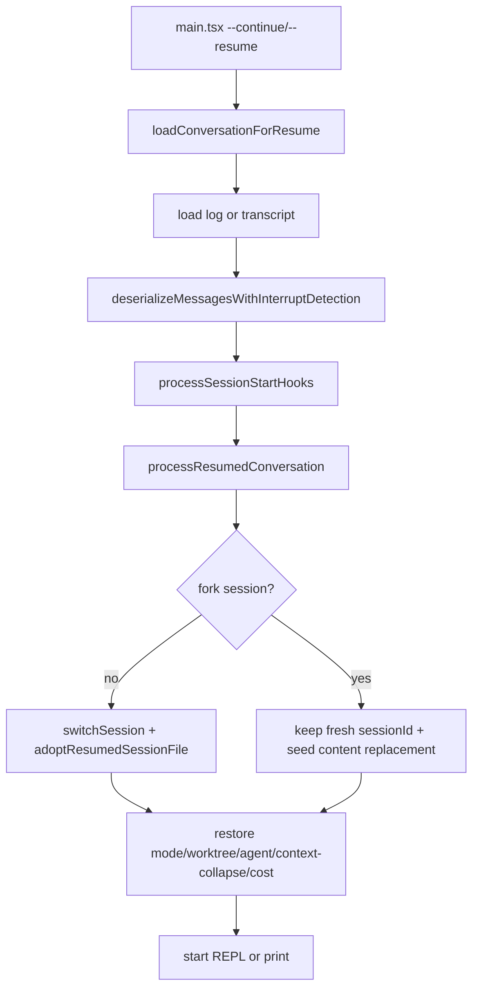
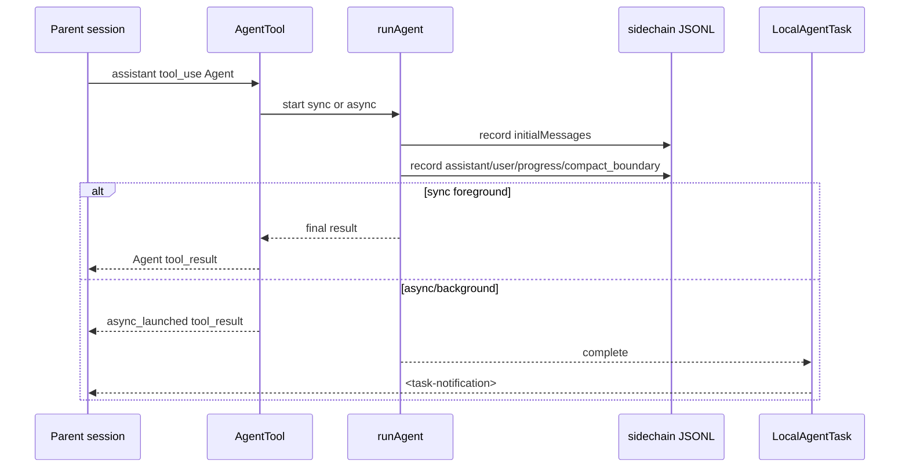
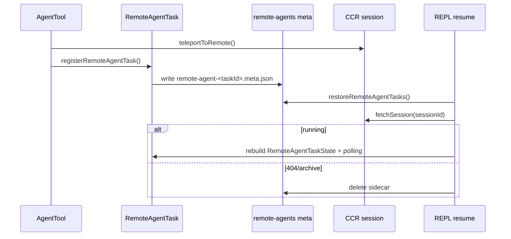

# JSONL Transcript Session Persistence and Recovery

This document covers how Claude Code persists and recovers sessions from JSONL transcripts, and how it handles error recovery, context compaction, branching, subagents, fork agents, and remote agents.

It is not a file-by-file list of source notes. It is a mechanism handbook: build the mental model first, then look at the data structures, lifecycles, failure paths, and source entry points.

## How to read this

| If you want to understand | Read first |
|---|---|
| Why resume lands in the right place | `Overview`, `Reading and chain reconstruction`, `Recovery entry points` |
| Why history still exists after compact but the model cannot see it | `Context views`, `Compact and projection` |
| Why subagents do not pollute the main session | `Storage topology`, `Subagents and fork agents` |
| How `/branch`, `--fork-session`, and `/fork` differ | `Branch vs. fork comparison` |
| How crashes, overflows, and cancellations are recovered | `Error recovery matrix` |

## Overview

The local session core of Claude Code is an append-only JSONL file. Each line is an `Entry`, but on recovery the whole file is not replayed in file order. Instead:

1. Transcript messages go into a `uuid -> message` map.
2. Metadata entries go into their own maps or arrays.
3. The latest leaf is selected.
4. The current valid chain is obtained by walking back from the leaf along `parentUuid`.
5. Projections such as compact, snip, preserved segment, and content replacement are applied.
6. In-memory state is restored: sessionId, worktree, mode, agent setting, task state, and so on.

Core invariants:

| Invariant | Meaning |
|---|---|
| JSONL is append-only where possible | compact, branch, and sidechain all prefer appending new entries over modifying old history. |
| `uuid/parentUuid` define the timeline | File order only records write order; recovery relies on walking the chain back. |
| Metadata is not part of the main chain | title, tag, worktree, content replacement, etc. are merged by sessionId/messageId/agentId. |
| compact does not delete history | It appends a boundary; the model view starts after the last boundary. |
| A subagent is a sidechain | The subagent's full conversation lives in a separate JSONL; the parent session only sees the Agent tool's result/notification. |
| A remote agent is not a sidechain | A remote agent keeps only a sidecar identity locally; execution state comes from CCR. |

### System layers



### Storage topology

```text
~/.claude/projects/<project-key>/
  <sessionId>.jsonl
  <sessionId>/
    subagents/
      agent-<agentId>.jsonl
      agent-<agentId>.meta.json
      <subdir>/
        agent-<agentId>.jsonl
        agent-<agentId>.meta.json
    remote-agents/
      remote-agent-<taskId>.meta.json
```

| File | Generated by | Purpose |
|---|---|---|
| `<sessionId>.jsonl` | `getTranscriptPath()` | Main session transcript. |
| `subagents/agent-<agentId>.jsonl` | `getAgentTranscriptPath(agentId)` | Local subagent / fork agent sidechain. |
| `subagents/agent-<agentId>.meta.json` | `getAgentMetadataPath(agentId)` | agentType, worktreePath, description. |
| `remote-agents/remote-agent-<taskId>.meta.json` | `getRemoteAgentMetadataPath(taskId)` | Remote CCR session identity, used to resume polling. |

## Core source map

| Mechanism | Main files |
|---|---|
| Entry types | `src/types/logs.ts` |
| Paths, writing, reading, chain reconstruction | `src/utils/sessionStorage.ts` |
| Streaming reads of large files | `src/utils/sessionStoragePortable.ts` |
| CLI resume loading and interrupt detection | `src/utils/conversationRecovery.ts` |
| Session switching and state restore | `src/utils/sessionRestore.ts` |
| SDK/headless query transcript writes | `src/QueryEngine.ts` |
| API query loop, compact, error recovery | `src/query.ts` |
| compact implementation | `src/services/compact/*` |
| context-collapse stub and persistence interface | `src/services/contextCollapse/*` |
| `/branch` | `src/commands/branch/branch.ts` |
| `/fork` | `src/commands/fork/fork.tsx` |
| AgentTool and subagents | `packages/builtin-tools/src/tools/AgentTool/*` |
| Generic forked side query | `src/utils/forkedAgent.ts` |
| remote agent task | `src/tasks/RemoteAgentTask/RemoteAgentTask.tsx` |

## Data model

`Entry` is defined in `src/types/logs.ts` and falls into three broad groups.

| Category | Typical type | In the `parentUuid` chain | Key | Recovery use |
|---|---|---:|---|---|
| transcript message | `user`, `assistant`, `attachment`, `system` | Yes | `uuid` | Rebuild the conversation chain, model context, and UI scrollback. |
| session metadata | `custom-title`, `tag`, `mode`, `worktree-state`, `pr-link`, `agent-setting` | No | `sessionId` | Restore title, tags, mode, worktree, PR, and agent settings. |
| message metadata | `file-history-snapshot`, `attribution-snapshot`, `summary` | No | `messageId` or `leafUuid` | Restore file history, attribution, and summaries. |
| replacement metadata | `content-replacement` | No | `sessionId` + optional `agentId` | Restore replacement decisions for large tool_results. |
| context-collapse metadata | `marble-origami-commit`, `marble-origami-snapshot` | No | `sessionId` | Reserved context-collapse recovery interface; the current implementation is a stub. |
| queue/task metadata | `queue-operation`, `task-summary`, `speculation-accept` | No | Own fields | Restore queues, task summaries, and speculation acceptance stats. |

### TranscriptMessage fields

`TranscriptMessage` is what actually participates in the chain:

| Field | Meaning |
|---|---|
| `uuid` | Current message ID. |
| `parentUuid` | Chain parent; recovery walks back along it. |
| `logicalParentUuid` | Keeps the logical parent where the chain is broken, such as at a compact boundary. |
| `sessionId` | The main session it belongs to. |
| `cwd` | Working directory at write time. |
| `timestamp` | Write time. |
| `version` | CLI version. |
| `gitBranch` | Git branch at write time. |
| `isSidechain` | Whether this is a subagent sidechain. |
| `agentId` | The agent a sidechain belongs to. |
| `teamName/agentName/agentColor` | swarm / teammate display metadata. |

### JSONL examples

Main session messages:

```jsonl
{"type":"user","uuid":"u1","parentUuid":null,"sessionId":"s1","isSidechain":false,"cwd":"/home/user/project","message":{"role":"user","content":"Fix the tests"}}
{"type":"assistant","uuid":"a1","parentUuid":"u1","sessionId":"s1","isSidechain":false,"message":{"role":"assistant","content":[{"type":"text","text":"Let me take a look."}]}}
```

Sidechain message:

```jsonl
{"type":"user","uuid":"u2","parentUuid":null,"sessionId":"s1","isSidechain":true,"agentId":"ag1","message":{"role":"user","content":"Analyze the compact path"}}
```

An agent's `content-replacement`:

```jsonl
{"type":"content-replacement","sessionId":"s1","agentId":"ag1","replacements":[{"messageUuid":"u2","toolUseId":"toolu_...","blockIndex":0,"kind":"persisted"}]}
```

compact boundary:

```jsonl
{"type":"system","subtype":"compact_boundary","uuid":"b1","parentUuid":"a9","logicalParentUuid":"a9","sessionId":"s1","compactMetadata":{"trigger":"auto","preTokens":182000,"messagesSummarized":94}}
```

## Write lifecycle

### Overall flow



Key points:

| Design | Why |
|---|---|
| User input is written to the transcript before it goes to the API | If the process crashes before the API call, resume can still see the user prompt. |
| Assistant streaming writes are mostly fire-and-forget | Does not block token streaming. |
| Flush before result when needed | Prevents the tail from being lost when an SDK/desktop client kills the process right after receiving the result. |
| `progress` is not part of the chain | High-frequency progress ticks should not create forks or bloat the transcript. |

### Main session writes

Entry point: `recordTranscript(messages, teamInfo?, startingParentUuidHint?, allMessages?)`.

Flow:

1. `cleanMessagesForLogging()` filters out UI-only messages and messages that should not be persisted.
2. `getSessionMessages(sessionId)` reads the UUID set already written for the current session.
3. `insertMessageChain()` is called for messages not yet written.
4. `insertMessageChain()` fills in `parentUuid/sessionId/cwd/timestamp/version/gitBranch/isSidechain`.
5. `appendEntry()` puts the entry into the per-file queue.

Deduplication does not simply drop every duplicate: if some messages in the prefix were already written, the writer advances `startingParentUuid` so later new messages attach to the correct parent.

### Write queue, materialize, and flush

`Project` maintains a per-file queue internally:

| Mechanism | Details |
|---|---|
| `writeQueues` | `Map<filePath, entry[]>`, aggregating writes per file. |
| drain timer | 100ms by default; about 10ms for CCR/remote persistence. |
| queue limit | When a single queue exceeds 1000 entries, the oldest queued entry is dropped and resolved, to keep memory from growing without bound. |
| chunk limit | A single JSONL append chunk is about 100MB. |
| `flushSessionStorage()` | Cancels the timer and waits for the active drain and tracked writes. |

`sessionFile` starts as `null`. Until then, metadata such as title, tag, mode, and worktree is held in memory or in `pendingEntries`. Only when the first `user` or `assistant` message appears does `materializeSessionFile()` create the session file, and then:

1. Writes the cached metadata.
2. Replays pending entries.
3. Appends all later entries normally.

This avoids producing a metadata-only session just because the CLI was opened without saying anything, which would pollute the `/resume` list.

### Sidechain writes

A subagent uses `recordSidechainTranscript(messages, agentId, startingParentUuid?)`.

It still goes through `insertMessageChain()` underneath, but the fields written differ:

```ts
isSidechain: true
agentId: agentId
```

When `appendEntry()` sees a transcript message with `isSidechain && agentId`, it routes it to:

```text
<project>/<sessionId>/subagents/agent-<agentId>.jsonl
```

A `content-replacement` that carries an `agentId` is also routed to that agent's sidechain JSONL instead of the main session JSONL.

One important exception: sidechain writes do not dedupe against the main session's UUID set. A fork agent reuses the parent session's message UUIDs to inherit context; deduping against the main session would wrongly remove the inherited context from the sidechain, leaving only the child prompt when the agent is resumed.

## Reading and chain reconstruction

### From JSONL to the valid chain

```mermaid
flowchart TD
  A[loadTranscriptFile(file)] --> B[readTranscriptForLoad<br/>large files read in chunks]
  B --> C[parseJSONL Entry]
  C --> D[messages Map uuid->TranscriptMessage]
  C --> E[metadata maps/arrays]
  D --> F[progress bridge / preserved relink / snip removal]
  F --> G[select leaf]
  G --> H[buildConversationChain]
  H --> I[recoverOrphanedParallelToolResults]
  I --> J[LogOption or agent transcript]
```

`loadTranscriptFile(filePath, opts?)` produces:

| Output | Purpose |
|---|---|
| `messages` | `uuid -> TranscriptMessage`. |
| `leafUuids` | Candidate leaves. |
| title/tag/mode/worktree/PR maps | Session metadata. |
| `fileHistorySnapshots` / `attributionSnapshots` | File state recovery. |
| `contentReplacements` | Main-thread replacement records. |
| `agentContentReplacements` | `agentId -> replacement records`. |
| `contextCollapseCommits` / `contextCollapseSnapshot` | Inputs for context-collapse recovery. |

### Leaf and parent chain

`buildConversationChain(messages, leaf)`:

1. Starts at the leaf.
2. Reads `parentUuid`.
3. Finds the parent message and keeps walking back.
4. Detects parent cycles to avoid infinite loops.
5. Reverses into a forward-order transcript.
6. Restores DAG branches formed by parallel tool_use.

A simplified example:

```text
u1 <- a1 <- u2 <- a2
                 ^
               leaf

Recovery chain: a2 -> u2 -> a1 -> u1
Forward chain:  u1, a1, u2, a2
```

File order is not the valid chain. Branching, rewind, and streaming fallback can all leave dead branches in the JSONL; recovery only picks the timeline the current leaf belongs to.

### Metadata merge rules

| metadata | Merge strategy | Notes |
|---|---|---|
| `custom-title`, `tag`, `mode`, `worktree-state`, `pr-link`, `agent-setting` | sessionId keyed, usually last-wins | Restores the latest session state. |
| `file-history-snapshot`, `attribution-snapshot` | messageId keyed / array | Restores file history and attribution. |
| `content-replacement` | append array | Replacement decisions from every turn must be kept. |
| `agentContentReplacements` | agentId keyed + append array | Rebuilds the sidechain replacement state on agent resume. |
| `marble-origami-commit` | ordered array | Order is meaningful; a later commit may reference an earlier summary. |
| `marble-origami-snapshot` | last-wins | Only the latest staged snapshot is restored. |

### Large file read optimizations

A transcript can grow to hundreds of MB or even GB, so the read path has several layers of protection.

| Optimization | Location | Purpose |
|---|---|---|
| Chunked reads | `readTranscriptForLoad()` | Avoids reading everything into memory at once. |
| Skipping large metadata at the fd layer | `readTranscriptForLoad()` | Large entries such as `attribution-snapshot` never enter the buffer. |
| Skipping the pre-compact prefix | `readTranscriptForLoad()` | After a non-preserved compact boundary, only content after the boundary is kept. |
| Pre-boundary metadata scan | `scanPreBoundaryMetadata()` | Even when the pre-compact part is skipped, display info such as title/tag/mode/worktree/PR is kept. |
| Byte-level dead branch pruning | `walkChainBeforeParse()` | Before JSON.parse, only the active chain and metadata are concatenated, skipping dead fork/rewind branches. |
| Lite read limit | `MAX_TRANSCRIPT_READ_BYTES` | Callers that read the raw transcript directly should avoid anything above about 50MB. |

`walkChainBeforeParse()` only concatenates when it expects to drop at least half of the buffer, so the optimization itself does not become extra cost.

### Preserved segment and snip

A compact boundary can carry `compactMetadata.preservedSegment`. On recovery, `applyPreservedSegmentRelinks()`:

1. Verifies that the `tailUuid -> headUuid` chain is intact.
2. Attaches the head of the preserved segment after the compact anchor.
3. Re-attaches the anchor's other children to the preserved tail.
4. Deletes old messages before the last boundary that are not part of the preserved segment.
5. Zeroes the usage of preserved assistant messages so that recovery does not immediately trigger autocompact again.

Illustration:

```text
Before compact: old... -> anchor -> head -> ... -> tail -> next
After compact:  boundary/summary -> head -> ... -> tail -> next
```

`snip` differs from compact: compact truncates a prefix, snip removes a middle section. JSONL cannot actually delete old lines, so `applySnipRemovals()` deletes `removedUuids` from the in-memory map, then reconnects dangling `parentUuid` values to the nearest surviving ancestor.

### Legacy chain repairs

| Problem | Repair |
|---|---|
| Legacy `progress` once entered the parent chain | `progressBridge` rewrites parents that point to progress back to progress's real parent. |
| Parent cycle | `buildConversationChain()` detects the cycle, logs it, and returns a partial chain. |
| Parallel tool_use forming a DAG | `recoverOrphanedParallelToolResults()` restores siblings using the assistant `message.id` and tool_result parent relations. |
| Orphan tail from streaming fallback | A tombstone triggers `removeTranscriptMessage(uuid)` to delete the failed attempt. |

## Recovery entry points

### Entry matrix

| Entry | Load source | Reuses original sessionId | Adopts original JSONL | Notes |
|---|---|---:|---:|---|
| `--continue` | Most recent session in the current directory | Yes | Yes | Skips non-interactive bg/daemon sessions that are still live. |
| `--resume <uuid>` | Specified session | Yes | Yes | Also supports custom title / search term / picker. |
| `--resume <jsonl>` | Specified JSONL file | Yes | Yes | Supported on Ant-internal/print paths. |
| `--fork-session` + resume | Old session messages | No | No | Keeps a new sessionId and uses the old messages as the new session's initial content. |
| `--resume-session-at <message.id>` | print/headless resume | Depends on resume | Depends on resume | Truncates to the specified assistant message. |
| REPL `/resume` | picker / log option | Yes or fork | Yes or no | Runs SessionEnd/SessionStart hooks and switches UI state. |

### CLI resume flow



Core functions:

| Function | Responsibility |
|---|---|
| `loadConversationForResume()` | Uniformly loads the most recent session, sessionId, LogOption, or JSONL path; fills in the lite log; copies plan/file history; runs the consistency check; deserializes and detects interruptions; returns metadata. |
| `processResumedConversation()` | Startup recovery for CLI interactive mode; switches or forks the session; restores cost, worktree, mode, agent setting, context-collapse, and attribution. |
| `restoreSessionStateFromLog()` | Restores AppState-side state: file history, attribution, context-collapse, TodoWrite todos. |

### REPL `/resume`

Resuming inside the REPL has extra work compared with the CLI startup path, namely switching from the current session to another:

1. Clean the target log messages.
2. Run SessionEnd hooks for the current session.
3. Run SessionStart resume hooks for the target session.
4. Save the current session's cost and restore the target session's cost.
5. `switchSession(sessionId, dirname(fullPath))` atomically switches sessionId and project dir.
6. `resetSessionFilePointer()` and restore the metadata cache.
7. When not forking, exit the previous worktree, restore the target worktree, and `adoptResumedSessionFile()`.
8. When forking, do not adopt the original transcript and do not exit the current worktree.
9. Rebuild the content replacement state.
10. Restore remote/local task state.
11. Replace messages, clear tool JSX, and clear the input box.

### Interrupt detection matrix

`deserializeMessagesWithInterruptDetection()` first cleans the history:

| Cleanup | Purpose |
|---|---|
| Legacy attachment migration | Compatibility with old transcripts. |
| Remove invalid `permissionMode` | Prevents invalid enum values from other builds from entering runtime state. |
| Filter unresolved tool_use | Avoids API errors about unpaired tool_use/tool_result. |
| Filter orphaned thinking-only assistant | Avoids an orphan thinking block left by an interrupted stream. |
| Filter whitespace-only assistant | Avoids a blank assistant left behind by a cancellation. |

It then looks at the last turn-relevant message:

| Last valid message | Result | Extra action |
|---|---|---|
| assistant | `none` | stop_reason is often null in streamed persistence, so it cannot be used to judge incompleteness. |
| Ordinary user | `interrupted_prompt` | Inserts a `NO_RESPONSE_REQUESTED` sentinel to stay API-valid. |
| meta user / compact summary user | `none` | Internal control messages are not treated as a new user request. |
| tool_result user | Usually `interrupted_turn` | Exception: terminal tool_results from Brief/SendUserMessage/SendUserFile count as complete. |
| attachment | `interrupted_turn` | Appends a meta user: `Continue from where you left off.` |
| system/progress/API error assistant | Skipped | Not used to decide whether the turn completed. |

`interrupted_turn` is uniformly converted to `interrupted_prompt`, so upper layers only handle one "needs to continue" state.

## Error recovery matrix

| Scenario | Handling | Transcript impact |
|---|---|---|
| Process crash before the API call | The user prompt was already written first by `QueryEngine.ask()`. | Resume sees an ordinary user message and triggers `interrupted_prompt`. |
| Streaming fallback produces an orphan assistant | Yield a tombstone; the REPL removes the UI message and calls `removeTranscriptMessage(uuid)`. | Prefers modifying only the last 64KB of the JSONL; skips the slow rewrite when the target of a large file is not in the tail. |
| prompt-too-long / media-too-large | Withheld during streaming; first a context-collapse drain, then a reactive compact; the error is exposed only on failure. | If compact succeeds, a boundary/summary is written and the request retried; the API error message is written only on failure. |
| max_output_tokens | First raise the max output override; if it still fails, inject an internal recovery prompt to continue; the error is exposed only when retries are exhausted. | The internal retry prompt does not necessarily become an ordinary transcript entry, depending on whether it is yielded to the outer layer. |
| auto compact off but at the blocking limit | Directly yields a prompt-too-long-style API error. | Leaves room for the user's manual `/compact`. |
| abort during streaming/tools | Fills in missing tool_results and, if needed, yields a user interruption message. | When `reason === interrupt`, the interruption message is skipped because the later queued user message already provides context. |
| stop hook blocking | Adds the hook blocking error to state and retries. | A reactive compact guard prevents an infinite hook/error/compact loop. |
| compact boundary points at an unflushed tail | QueryEngine forcibly writes the messages before the preserved tail before writing the boundary. | Prevents the boundary from referencing a nonexistent UUID on recovery. |
| Incomplete tail in a subagent transcript | `resumeAgentBackground()` filters unresolved tool_use, orphan thinking, and blank assistant again. | Avoids an invalid API request after the agent is resumed. |

## Context views

The same messages have four views in the system; do not mix them up:

| View | Contents | Used by |
|---|---|---|
| Raw transcript | All entries in the JSONL, including old history, dead branches, metadata, and sidechains. | Disk persistence and auditing. |
| UI scrollback | The messages the REPL currently displays; may keep pre-compact history and collapsed UI groups. | Terminal UI. |
| Active query view | Messages after `getMessagesAfterCompactBoundary()`, with the snip projection applied by default. | `query.ts` context management. |
| API wire view | After `normalizeMessagesForAPI()`: system boundaries filtered, tool pairing repaired, cache edits inserted. | API clients such as Anthropic/OpenAI/Gemini. |

The order in which the active context is built for each query turn:

1. `getMessagesAfterCompactBoundary(messages)`: takes the active slice after the most recent compact boundary, with the snip projection layered on by default.
2. Drop old raw `toolUseResult` payloads, keeping only the `message.content` the API needs.
3. `applyToolResultBudget()`: oversized tool_results are replaced with a preview/stub, and a `content-replacement` is written.
4. `snipCompactIfNeeded()`: under `HISTORY_SNIP`, removes the middle of the history.
5. `microcompactMessages()`: time-based microcompact, then cached microcompact.
6. `contextCollapse.applyCollapsesIfNeeded()`: currently an identity stub.
7. `autoCompactIfNeeded()`: proactive compact, preferring session memory compact.
8. Predictive autocompact: estimates this turn's growth before the API call and compacts early if needed.
9. After a real API overflow: context-collapse drain, then reactive compact.

## Compact and projection

### Compact type comparison

| Type | Trigger | Summary source | Calls the compact API | Keeps a tail | Failure strategy |
|---|---|---|---:|---:|---|
| manual compact | `/compact` | compact summary API or session memory | Depends on path | Depends on full/partial/SM | Shows the failure or falls back to traditional compact. |
| auto compact | Token threshold | Session memory first, then summary API | Depends on path | Depends on path | Circuit breaker on consecutive failures; stops auto compact after 3 by default. |
| predictive compact | Estimated growth before the API call | Same as auto compact | Depends on path | Depends on path | On failure, continues the original request or goes to later error recovery. |
| reactive compact | After a real API 413/media error | `compactConversation()` | Yes | The current wrapper depends on the compact implementation | `hasAttemptedReactiveCompact` prevents loops. |
| session memory compact | Tried first in manual/auto | session memory file | No | Yes | If still over the threshold after post-compact, gives up and falls back to traditional compact. |
| microcompact | Small time/cached compaction | Local cleanup or API cache edit | Not necessarily | N/A | Usually does not change the main JSONL history. |
| snip | `HISTORY_SNIP` | Removes the middle | No | Keeps the context before and after | Projected via snip metadata; old lines are not physically deleted. |

### Shape of a compact result

Traditional compact produces:

1. A `compact_boundary` system message.
2. A compact summary user message.
3. Post-compact attachments, such as current files, plan mode, skills, MCP/tool schema delta, and hook results.

Simplified before/after:

```text
Raw/UI:
  u1, a1, u2, a2, ... u99, a99,
  system:compact_boundary,
  user:compact summary,
  attachment:current files,
  u100

Active query view:
  system:compact_boundary,
  user:compact summary,
  attachment:current files,
  u100

API wire view:
  user:compact summary,
  attachment/content,
  u100
```

The boundary itself is a system message and is filtered out by API normalization in the end; its value lies mainly in local projection, recovery, and statistics.

### Boundary metadata

`createCompactBoundaryMessage()` writes:

| Field | Meaning |
|---|---|
| `compactMetadata.trigger` | `manual` or `auto`. |
| `compactMetadata.preTokens` | Token count before compact. |
| `compactMetadata.userContext` | Extra notes from a user-initiated manual compact. |
| `compactMetadata.messagesSummarized` | Number of messages summarized. |
| `logicalParentUuid` | The last message before compact, used for logical tracking. |

Later code paths add:

| Field | Source | Purpose |
|---|---|---|
| `preCompactDiscoveredTools` | traditional/SM compact | Restores visibility of deferred tool schemas. |
| `preservedSegment.{headUuid,anchorUuid,tailUuid}` | partial/SM compact | On recovery, attaches the preserved tail after the boundary. |

### Tool result budget and content replacement

A large tool_result does not necessarily go straight into later context. `applyToolResultBudget()` aggregates the budget per API-level user message and, when needed, persists large content and replaces it with a smaller preview/stub.

Key points:

| Point | Notes |
|---|---|
| Replacement decisions are written to the JSONL | `recordContentReplacement()` writes `content-replacement`. |
| Main thread and agents are separate | Without `agentId` it goes to the main JSONL; with `agentId` it goes to the sidechain JSONL. |
| Resume rebuilds the replacement state | Prevents the same large result from reverting to full content after recovery, which would blow up tokens or break the prompt cache. |
| `--fork-session` seeds records | When forking a new session, replacement decisions are copied to the new session. |

### Session memory compact

`sessionMemoryCompact.ts` is an experimental path ahead of the traditional summary compact. Flow:

1. Wait for session memory extraction to finish.
2. Read the session memory file.
3. If `lastSummarizedMessageId` exists, keep a safe tail after it; otherwise treat the resumed session as already having a memory summary.
4. Adjust the cut point so that tool_use/tool_result pairs or thinking blocks are not split.
5. Create a standard `compact_boundary` + summary user message.
6. If the post-compact token count is still over the threshold, give up and fall back to traditional compact.

Because the output is still a standard `CompactionResult`, the downstream transcript writing and recovery logic is shared with traditional compact.

### Context-collapse current status

This repository keeps the persistence interface for context-collapse, but the core implementation is a stub:

| Module | Current behavior |
|---|---|
| `contextCollapse/index.ts` | `applyCollapsesIfNeeded()` returns the original messages; `recoverFromOverflow()` returns committed=0; `isWithheldPromptTooLong()` is always false. |
| `contextCollapse/operations.ts` | `projectView()` is an identity. |
| `contextCollapse/persist.ts` | `restoreFromEntries()` is a no-op. |

JSONL entries already reserved:

| Entry | Write interface | Contents |
|---|---|---|
| `marble-origami-commit` | `recordContextCollapseCommit()` | `collapseId`, summary UUID/content, archived span boundaries. |
| `marble-origami-snapshot` | `recordContextCollapseSnapshot()` | staged spans, armed, lastSpawnTokens. |

The loader collects these entries; on encountering a compact boundary it clears the old commits/snapshot, so they never reference UUIDs that compact has already discarded.

So the context reduction that actually takes effect today is mainly compact, session memory compact, tool_result budget, microcompact, and snip; context-collapse only has its interface wired up.

### Post-compact cleanup

`runPostCompactCleanup(querySource)` always clears:

- microcompact state.
- system prompt sections.
- classifier approvals.
- speculative bash checks.
- beta tracing.
- session messages memo cache.
- compact cleanup callbacks.
- Under `COMMIT_ATTRIBUTION`, an async sweep of the file-content cache.

Cleared only on main-thread compact:

- context-collapse store.
- `getUserContext` cache.
- memory files cache.

Reason: subagents and the main thread share module-level state in the same process. If an `agent:*` compact cleared the main thread's context-collapse or memory cache, it would corrupt the parent session's state.

It explicitly does not clear `resetSentSkillNames()`, to avoid re-injecting the full skill listing after compact, which would waste tokens and prompt cache.

## Branch vs. fork comparison

| Entry | Essence | New main session | Subagent | Persistence location | What the parent session sees | Recovery |
|---|---|---:|---:|---|---|---|
| `/branch` | Copies the current main transcript into a new JSONL | Yes | No | `<newSessionId>.jsonl` | Switches directly to the new branch session | Ordinary session resume. |
| `--fork-session` | On resume/continue, uses old messages as the new session's initial messages | Yes | No | Materialized on the new session's first write | Starts out already continuing in the new session | New session resume. |
| `/fork <directive>` | Slash wrapper that calls AgentTool fork | No | Yes | `subagents/agent-<id>.jsonl` + `.meta.json` | fork started + task notification | `resumeAgentBackground()`. |
| `AgentTool({ fork: true })` | Tool-level forked subagent | No | Yes | `subagents/agent-<id>.jsonl` + `.meta.json` | Sync final tool_result or async notification | `resumeAgentBackground()`. |
| Ordinary AgentTool async | Background local subagent | No | Yes | `subagents/agent-<id>.jsonl` + `.meta.json` | `async_launched` + task notification | `resumeAgentBackground()`. |
| remote AgentTool | CCR remote session | No | Remote | `remote-agents/*.meta.json` | remote task output/notification | `restoreRemoteAgentTasks()` + CCR. |

### `/branch`

`/branch` creates a new session file; it does not append a branch marker to the original JSONL.

Flow:

1. Generate a new sessionId.
2. Read the current transcript file.
3. Filter main-session messages, excluding `isSidechain` and non-transcript entries.
4. Copy the messages and rewrite `sessionId`.
5. Re-chain `parentUuid`.
6. Add `forkedFrom: { sessionId, messageUuid }`.
7. Copy the original session's `content-replacement` entries and change them to the new sessionId.
8. Write `<newSessionId>.jsonl`.
9. Build a `LogOption` and have the REPL resume into the new branch.

### `--fork-session`

`--fork-session` only changes the ownership of the resume:

| Non-fork resume | fork-session resume |
|---|---|
| Switches to the old sessionId. | Keeps the fresh sessionId from startup. |
| `adoptResumedSessionFile()` takes over the old JSONL. | Does not take over the old JSONL. |
| Later writes keep appending to the old transcript. | Later writes materialize into a new transcript. |
| The original session keeps growing. | The original session is not written to. |

If the old session has `content-replacement`, the records are seeded into the new session first, so the replacement state of large tool_results is not lost.

## Subagents and fork agents

### Ordinary subagents

An ordinary AgentTool subagent ultimately goes through `runAgent()`:



The parent session usually records only:

- The Agent tool_use.
- The Agent tool_result.
- The async launch result.
- The task notification.
- Necessary progress.

The subagent's full internal tool calls and messages are in the sidechain JSONL and never mix into the main session's active context.

### Fork agents

A fork agent is a special kind of AgentTool subagent. It inherits the parent's context, system prompt, tools, model, and thinking config, so that multiple child agents share as long a byte-identical prompt cache prefix as possible.

Key implementation:

| Inherited | Implementation |
|---|---|
| system prompt | Prefers `toolUseContext.renderedSystemPrompt`, and only falls back to rebuilding it if absent. |
| tools | Uses the parent's `toolUseContext.options.tools`, with `useExactTools: true`. |
| model | `FORK_AGENT.model = "inherit"`. |
| thinking/non-interactive | Inherited through the exact tools/options, to avoid diverging cache keys. |
| messages | `forkContextMessages = toolUseContext.messages`. |

`buildForkedMessages()` builds a cache-friendly tail:

```text
parent history...
assistant: [text/thinking/tool_use A/tool_use B/...]
user:
  tool_result for A = "Fork started — processing in background"
  tool_result for B = "Fork started — processing in background"
  directive = "<this fork's task>"
```

Multiple fork children share the same long prefix; only the final directive differs.

Restrictions:

| Restriction | Reason |
|---|---|
| Requires the `FORK_SUBAGENT` feature. | Feature gate. |
| Disabled in coordinator mode. | The coordinator already has its own orchestration model. |
| Disabled in non-interactive sessions. | Fork subagents suit an interactive background-task model. |
| A fork child may not fork recursively. | Prevents infinite forking; detected via querySource and the boilerplate tag. |
| Resuming a fork agent no longer passes `forkContextMessages`. | The sidechain already contains the parent context slice; passing it again would cause duplicate tool_use ids. |

### `runForkedAgent()` is not an AgentTool fork

`runForkedAgent()` in `src/utils/forkedAgent.ts` is an internal cache-safe side-query utility, used for session memory, prompt suggestion, summaries, and the like. It reuses the parent's system/user/system context, tools, and messages, optionally with `skipTranscript`, but by default it does not write AgentTool metadata and is not an AgentTool fork the user can continue conversing with.

## Agent recovery

The entry point for recovering a local agent is `resumeAgentBackground()`.

Flow:

```mermaid
flowchart TD
  A[user continues agent] --> B[getAgentTranscript(agentId)]
  B --> C[load sidechain JSONL + build chain]
  C --> D[readAgentMetadata(agentId)]
  D --> E[filter unresolved tool_use/thinking/blank assistant]
  E --> F[reconstruct content replacement state]
  F --> G{metadata.worktreePath exists?}
  G -- yes --> H[runWithCwdOverride(worktreePath)]
  G -- no --> I[parent cwd]
  H --> J[register async LocalAgentTask]
  I --> J
  J --> K[continue query loop]
```

On recovery:

| State | Source |
|---|---|
| agent transcript | `agent-<agentId>.jsonl`. |
| agent type | `agent-<agentId>.meta.json`. |
| fork/general agent selection | metadata `agentType`. |
| worktree cwd | metadata `worktreePath`; falls back to the parent cwd if the directory no longer exists. |
| content replacement | sidechain records + parent live state gap-fill. |
| task UI | Re-registers the async task. |

## Remote agent recovery

A remote CCR agent does not continue executing from a local sidechain.



Differences:

| Local subagent | Remote agent |
|---|---|
| Has a full sidechain JSONL. | Has no local execution transcript. |
| Resume can continue the API conversation. | Resume only restores polling. |
| State comes from JSONL + `.meta.json`. | State comes from the CCR session + local sidecar. |
| The local sidechain remains auditable after completion. | The sidecar is deleted after completion/archival. |

## Common misconceptions

| Misconception | Correct understanding |
|---|---|
| JSONL order is the conversation order | Recovery relies on the leaf + `parentUuid`, not a simple sequential replay. |
| compact deleted the old history | compact appends a boundary; the old history is still in the raw transcript. |
| The boundary is sent to the model | The boundary is a local system marker and is filtered by API normalization. |
| `/branch` and `/fork` are both forks | `/branch` is a new main session; `/fork` is a forked subagent sidechain. |
| `--fork-session` equals `/branch` | It is not a file-copy command; it keeps fresh session ownership on resume. |
| Subagent messages enter the main context | The parent session only sees the Agent tool result/notification; the full internal messages are in the sidechain. |
| A remote agent has a local sidechain | A remote agent has only a sidecar identity; execution state comes from CCR. |
| context-collapse already really compresses context | In this repository the core context-collapse implementation is a stub. |

## Source entry index

| Question | Look here |
|---|---|
| Which types are in the Entry union | `Entry` in `src/types/logs.ts`. |
| Main transcript path | `getTranscriptPath()` in `src/utils/sessionStorage.ts`. |
| Subagent transcript path | `getAgentTranscriptPath(agentId)`. |
| Remote sidecar path | `getRemoteAgentsDir()` / `getRemoteAgentMetadataPath()`. |
| Main write | `recordTranscript()`. |
| Sidechain write | `recordSidechainTranscript()`. |
| Write queue | `Project.enqueueWrite()` / `drainWriteQueue()` / `flush()`. |
| Lazy materialize | `Project.materializeSessionFile()`. |
| Tombstone deletion | `removeTranscriptMessage()` / `Project.removeMessageByUuid()`. |
| Reading a transcript | `loadTranscriptFile()`. |
| Large-file reads | `readTranscriptForLoad()` in `sessionStoragePortable.ts`. |
| Dead branch pruning | `walkChainBeforeParse()`. |
| Parent chain reconstruction | `buildConversationChain()`. |
| Parallel tool_result restoration | `recoverOrphanedParallelToolResults()`. |
| Preserved segment | `applyPreservedSegmentRelinks()`. |
| Snip removal | `applySnipRemovals()`. |
| CLI resume loading | `loadConversationForResume()`. |
| Resume state switch | `processResumedConversation()`. |
| AppState restore | `restoreSessionStateFromLog()`. |
| Interrupt detection | `deserializeMessagesWithInterruptDetection()`. |
| Active context | `getMessagesAfterCompactBoundary()`. |
| Query context pipeline | `src/query.ts`. |
| Compact boundary | `createCompactBoundaryMessage()`. |
| Auto compact | `autoCompactIfNeeded()` / `shouldAutoCompact()`. |
| Session memory compact | `src/services/compact/sessionMemoryCompact.ts`. |
| Reactive compact | `src/services/compact/reactiveCompact.ts`. |
| Post compact cleanup | `runPostCompactCleanup()`. |
| context-collapse stub | `src/services/contextCollapse/*`. |
| `/branch` | `src/commands/branch/branch.ts`. |
| `/fork` | `src/commands/fork/fork.tsx`. |
| AgentTool fork | `AgentTool.tsx` + `forkSubagent.ts`. |
| Ordinary subagent execution | `runAgent.ts`. |
| Agent resume | `resumeAgent.ts`. |
| Remote task restore | `restoreRemoteAgentTasks()`. |
