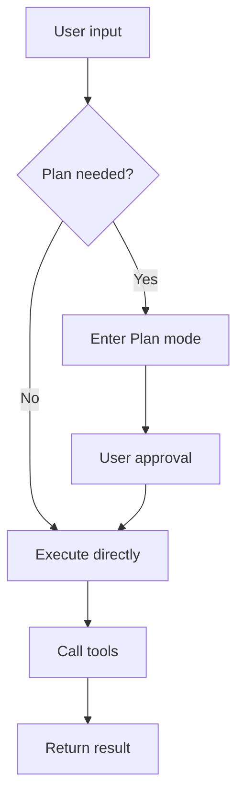
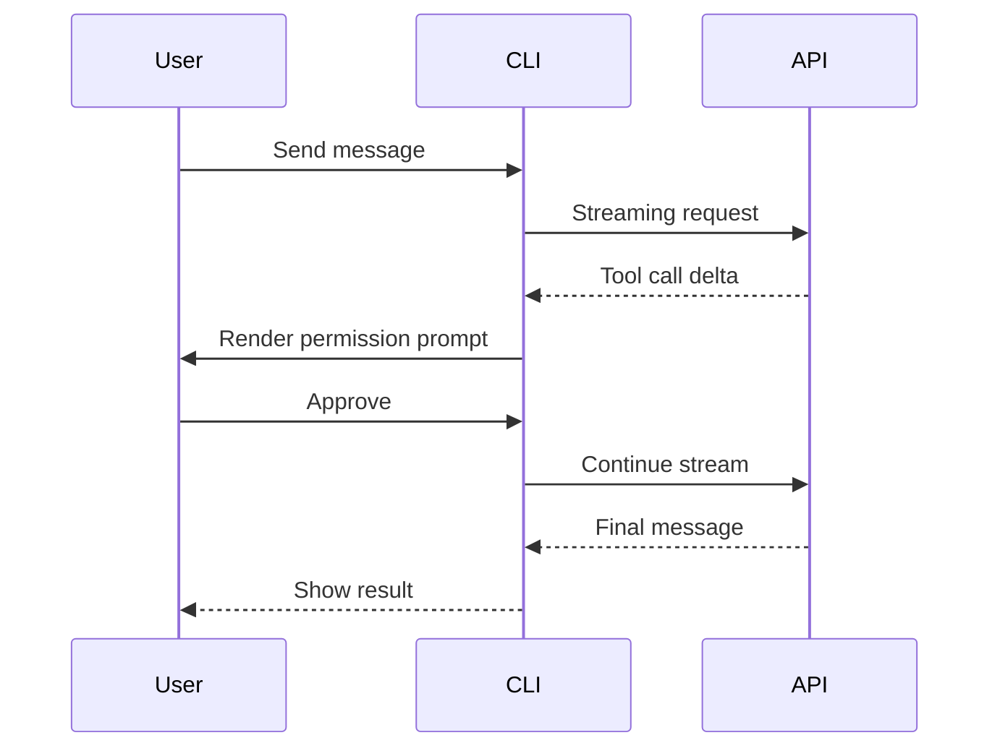
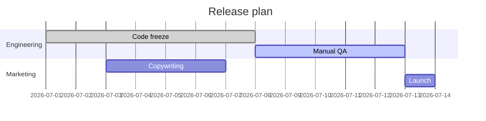

# Full-feature Markdown test

This document is for manually verifying that the `artifact` tool handles uploading, conversion, code highlighting and Mermaid rendering of `.md` files correctly. **Pass it straight to the `artifact` tool** (with `file_path` pointing at this file), then open the returned URL in a browser and check the sections below one by one.

## Inline formatting

The body paragraph contains **bold**, *italic*, ~~strikethrough~~, `inline code`, and a combination **bold + _italic_ + `code`**. There is also [a link](https://example.com) pointing to example.com.

Mixed CJK/English text is supported: Claude Orange `#D77757` 是 Anthropic 的主色 (the primary color of Anthropic). Emoji: 🚀 ✅ 🎯.

## Heading levels

Below is H2, followed by H3 / H4 / H5 / H6:

### H3 — third level
#### H4 — fourth level
##### H5 — fifth level
###### H6 — sixth level

## Lists

Unordered list:

- First item
- Second item
  - Nested item A
  - Nested item B
    - One level deeper
- Third item

Ordered list:

1. Step one
2. Step two
   1. Sub-step 2.1
   2. Sub-step 2.2
3. Step three

Task list (GFM):

- [x] Completed item
- [ ] Open item
- [ ] Another open item

## Tables

Mixed left / center / right alignment:

| Name       | Type     | Qty  | Notes          |
| ---------- | :------: | ---: | -------------- |
| Claude     | Model    |    1 | Recommended    |
| Opus 4.7   | Model    |    2 | Strongest      |
| Haiku 4.5  | Model    |    3 | Fastest        |

## Fenced code blocks (syntax highlighting)

TypeScript：

```ts
interface User {
  id: string
  name: string
  role: 'admin' | 'guest'
}

export async function fetchUser(id: string): Promise<User> {
  const res = await fetch(`/api/users/${id}`)
  if (!res.ok) throw new Error(`status ${res.status}`)
  return (await res.json()) as User
}
```

Python：

```python
from dataclasses import dataclass
from typing import Iterable

@dataclass
class Point:
    x: float
    y: float

def centroid(points: Iterable[Point]) -> Point:
    pts = list(points)
    n = len(pts)
    return Point(sum(p.x for p in pts) / n, sum(p.y for p in pts) / n)
```

Bash：

```bash
# Install dependencies and run tests
bun install
bun run precheck
```

JSON：

```json
{
  "name": "claude-code-best",
  "version": "2.2.1",
  "runtime": "bun",
  "features": ["buddy", "bridge_mode", "ultrathink"]
}
```

## Mermaid diagrams

Flowchart:



Sequence diagram:



Gantt chart:



## Quotes

> This is a quoted passage.
> The second line continues.

> Nested quote:
>
> > This is a deeper level.
>
> Back to the outer level.

## Horizontal rule

---

Above the horizontal rule.

## Inline HTML

HTML written directly is passed through: <kbd>Ctrl</kbd> + <kbd>C</kbd>, <span style="color: #D77757">Claude Orange text</span>.

## Conclusion

If all the sections above display correctly, the artifact tool's Markdown conversion, code highlighting (highlight.js) and Mermaid rendering are all in place.
